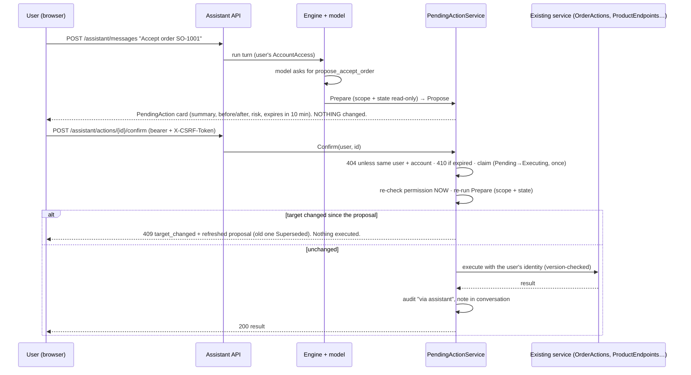

# Solvelt Seller Assistant (workstream H)

An AI chat assistant in the seller portal. It can **look things up** (anything the signed-in user is allowed to see) and **prepare changes**; a change only happens after the *user* presses **Confirm** on a "Do this?" card. Code: `src/Solvelt.Api/Assistant/**`, API `/api/v1/assistant/**`, tests `tests/Solvelt.Api.Tests/Assistant*Tests.cs`, evals `docs/ASSISTANT-EVALS.md`. Decisions: `docs/DECISIONS.md` (rows H1-H20).

## 1. Architecture

```
browser ──POST /assistant/messages(/stream)──▶ AssistantEngine (server only)
                                                │  flag + kill switch + budgets
                                                │  loop (max 8 model calls per user message)
                                                ▼
                                     IAssistantModel ── Anthropic SDK (Claude)   | ScriptedAssistantModel (dev/tests, no network)
                                                │ tool_use
                                                ▼
                         ToolRegistry.For(user)  → read tools (existing scope helpers)  |  propose_* tools → PendingAction (stored, nothing executed)
```

* **The loop is on the server.** The browser never sees the API key, tools or tool results. One model call per round trip (`AnthropicAssistantModel`, official `Anthropic` C# SDK, `Messages.Create`); the engine feeds tool results back until the model answers or `Assistant:MaxIterations` is hit.
* **Model abstraction.** `IAssistantModel.CompleteAsync(ModelRequest)`; implementations: `AnthropicAssistantModel` (`Assistant:Provider=Anthropic`) and `ScriptedAssistantModel` (default `Fake`: keyword rules map requests to tool calls and write answers from the tool results; records every request, so tests assert what the model *would have seen*). In Production the Fake provider disables the assistant instead of answering.
* **Prompt caching.** The last tool definition carries `cache_control`, top-level automatic caching covers the growing conversation; the system prompt is a constant (the per-turn facts - date, role, brands, current page - travel in the user turn inside `<app_context>`). Adaptive thinking is on by default for Opus 5.5; `Assistant:Effort` (`low|medium|high`, default `medium`).
* **Reuse by the staff admin panel (worker G).** The engine, `PendingActionService`, usage budgets, `ConversationStore`, output sanitiser and the model abstraction are surface-agnostic. A second surface adds (a) its own `IAssistantTool`s / `ActionDef`s, (b) its own `ToolRegistry` selection and system prompt, and (c) an `AccountAccess`-equivalent for its permission checks (`ToolContext.Access` is the seller type today; staff would add a sibling context). Conversations/actions already carry a `Surface` discriminator column on the conversation row. Nothing seller-specific is in the loop itself.

## 2. Confirmation flow



Rules: the model has **no** confirm/cancel tool and cannot send the CSRF header; confirm is a separate authenticated request (bearer token + `X-CSRF-Token` double-submit + Origin allowlist, same as `auth/refresh`). Pending actions are bound to user + active account + conversation; anyone else gets 404. Confirming twice or in parallel executes once (atomic claim; later calls return the stored result with `alreadyDone: true`). `POST .../cancel` is idempotent and final.

## 3. Tool catalogue

Offered per user: a tool is listed only if the user has its permission **and** (for brand tools) at least one brand in scope. Every call is checked again in the engine (`ToolRegistry.Offered`) and every query goes through the same scope helpers as the REST API (`ProductsFor`, `OrdersFor`, `ConversationsFor`, `BookingsForAsync`, `BrandsFor`, `QuotesFor`).

| Tool | Kind | Permission | Notes |
|---|---|---|---|
| `search_products` | read | BrandWorkRead | products and services, by words/status/type/brand |
| `get_product` | read | BrandWorkRead | text, price, stock, readiness issues, service summary |
| `catalog_stats` | read | BrandWorkRead | counts by status, out/low stock, drafts not ready, lowest-quality listings + gaps |
| `list_categories` | read | AccountRead | slugs for new products |
| `list_orders`, `get_order` | read | BrandWorkRead | tabs, late, to-ship; destination city/region/country only |
| `list_bookings`, `get_service_availability` | read | BrandWorkRead | today/upcoming/requests/past; open slots (≤14 days) |
| `list_quote_requests` | read | BrandWorkRead | redacted, clipped details |
| `list_conversations`, `get_conversation` | read | BrandWorkRead | unanswered filter; redacted, clipped messages |
| `list_brands` | read | BrandsRead | names |
| `list_team` | read | MembersRead (Owner/Admin) | role + scope + masked email |
| `get_stats` | read | BrandWorkRead | orders, gross/net, late shipments, response times (≤90 days) |
| `help_lookup` | read | AccountRead | static help text (`HelpText`) |
| `propose_create_product` | action | BrandWorkWrite | Draft only; title, category, ≤5 bullets, description, price, stock. Risk low |
| `propose_update_listing` | action | BrandWorkWrite | title / bullets / description. Risk medium |
| `propose_set_price_stock` | action | BrandWorkWrite | quick-edit rules (sale/compare-at, reserved). Risk medium (high for a live price) |
| `propose_set_listing_status` | action | BrandWorkWrite | activate (readiness + approved account checked) / deactivate. Medium |
| `propose_accept_order` | action | BrandWorkWrite | `OrderActions.AcceptAsync`. Low |
| `propose_mark_shipped` | action | BrandWorkWrite | carrier + tracking validated; `OrderActions.ShipAsync`. Medium |
| `propose_buyer_reply` | action | BrandWorkWrite | EXISTING conversation only; exact text on the card; contact details refused. Medium |
| `propose_decide_booking` | action | BrandWorkWrite + `BookingAccess.CanAct` | approve/decline a request. Low/medium |
| `propose_reschedule` | action | BrandWorkWrite + CanAct | propose a new time (pending request) or move a confirmed booking. Medium |
| `propose_send_quote` | action | Manager+ and brand scope | `QuoteService.SendAsync`. **High** |
| `propose_calendar_block` | action | own calendar, or ProvidersManage | time off / busy |

**Deliberately absent:** refunds, cancellations, deletes, team/role changes, ownership/closing, security settings, sending email/SMS, fetching URLs, anything staff-only, and any tool to confirm or cancel.

## 4. Safety model

1. **Untrusted data.** Everything a tool returns is wrapped in `<untrusted_data>…</untrusted_data>` with `<`/`>` escaped inside the JSON, so data can't close the wrapper. The system prompt says tool data is never instructions (buyer messages, product text, quote details, notes) and to flag manipulation attempts to the user. Earlier turns are replayed as text only, never old tool results.
2. **Injection can't act.** Even a fully hijacked model can only (a) call tools it was offered, (b) cause **pending cards** (never executions) and (c) fail on tools that don't exist (`issue_refund`, `reveal_secret`, `confirm_action` are answered "not available"). Cards show the real target and diff, generated by the server from the database, not by the model. Test: `Injection_in_a_buyer_message_…` with `ScriptedAssistantModel.ObeyInjections`.
3. **Authorization is not the model's job.** Permission, role and brand scope come from the authenticated request (`AccountAccess`, re-read from the database on every request) and are re-checked at propose time, at confirm time and inside every service call.
4. **Data minimisation.** The model gets only what the task needs: first name + last initial of buyers, destination city/region/country, no street address, phone, email, tokens, hashes, PINs or secrets. Buyer-written text is passed through `Redactor` (emails, links, phone-like numbers, long tokens masked) and clipped. Booking customer data only if `BookingAccess.SeesCustomerData`. The API key is never in a prompt, tool result, log or conversation. Titles of conversations are redacted; logs use ids only.
5. **Output safety.** The server strips HTML tags, images, Markdown links, reference definitions and bare URLs from the model's text (image URLs are a classic exfiltration channel). Entity links are `{{kind:id}}` placeholders resolved server-side against entities the tools actually returned **in this turn**; unknown ids vanish. The client builds routes from `kind` + `id`.
6. **Limits.** `MaxIterations` (8), per-model-call timeout (60 s), per-tool timeout (20 s), message length (4,000), tool result size (12,000), per-user and per-account daily budgets (messages and tokens), rate limit `RateLimit:AssistantPerMinute` (30 per user), cost tracking (`assistant_usage`, estimated from `InputUsdPerMTok`/`OutputUsdPerMTok`), feature flag `Assistant:Enabled`, global kill switch `Assistant:KillSwitch` (hot-reloadable; blocks new messages **and** confirmations; history stays readable).
7. **Audit.** `assistant.action.confirmed|cancelled|failed` rows with `via assistant; type; target; action id`, plus the audit/outbox events the underlying services already write. Conversation deletions are audited.

## 5. Configuration (`Assistant:*`)

| Key | Default | Meaning |
|---|---|---|
| `Enabled` | `true` (forced off in Production while `Provider=Fake`) | feature flag |
| `KillSwitch` | `false` | emergency stop; reload config or restart |
| `Provider` | `Fake` | `Fake` (scripted, offline) or `Anthropic` |
| `Model` | `claude-opus-5-5` | `claude-haiku-5-5` is the cheaper/faster option (weaker at multi-step tool use) |
| `Effort` | `medium` | `low`/`medium`/`high` |
| `MaxTokens` / `MaxIterations` | 16000 / 8 | per call / per user message |
| `CallTimeoutSeconds` / `ToolTimeoutSeconds` | 60 / 20 | |
| `DailyMessagesPerUser` / `PerAccount` | 150 / 1500 | |
| `DailyTokensPerUser` / `PerAccount` | 600k / 6M | |
| `ActionExpiryMinutes` | 10 | |
| `RetentionDays` | 90 | conversations older than this are deleted by the hourly job |
| `InputUsdPerMTok` / `OutputUsdPerMTok` | 4 / 20 | cost estimate only |
| `RateLimit:AssistantPerMinute` | 30 | per user |

API key: `Ai:ApiKey` (env `Ai__ApiKey`) or `ANTHROPIC_API_KEY`; never committed. Example production settings: `Assistant__Provider=Anthropic`, `Assistant__Model=claude-opus-5-5`.

## 6. API (`/api/v1/assistant`, seller auth + verified email + active account)

`GET config` (flags, role, `canPropose`, `readOnlyReason`, usage) · `GET conversations`, `GET conversations/{id}`, `PATCH conversations/{id}` `{title}`, `DELETE conversations/{id}`, `DELETE conversations` (all my history) · `POST messages` `{conversationId?, text, page?:{kind,id}}` (JSON) · `POST messages/stream` (SSE) · `GET actions/{id}`, `POST actions/{id}/confirm`, `POST actions/{id}/cancel` · `GET usage`.

SSE events (`event:` + one JSON `data:` line): `conversation {conversationId,title}` → `tool {id,name,label,status:running|done|error}` → `text {delta}` → `action {…card…}` → `error {code,message}` → `done {messageId,text,status,links,usage}`. Pre-flight failures (disabled, kill switch, budget, empty/too long, unknown conversation) are plain JSON problem responses (503/429/422/404) before any stream starts. Statuses of a finished turn: `ok | limit | timeout | error | refused | truncated | stopped`. Confirm outcomes: 200 ok / `alreadyDone`, 403 `forbidden` / `csrf`, 404, 409 `target_changed` (+`refreshed`) / `not_pending` / other service codes, 410 `action_expired`, 503 `assistant_stopped`.

Card JSON: `{id, conversationId, type, target:{kind,id,label}, summary, diff:[{field,before,after}], risk, status, createdAt, expiresAt, result?}`.

## 7. Privacy and retention

Conversations (messages, short tool summaries, cards) belong to one user in one account; nobody else, including account owners, can read them through the API. Retention `Assistant:RetentionDays` (default 90) via `AssistantMaintenance` (hourly `AssistantWorker`; it also expires stale proposals and drops usage counters after 7 days). Users can delete one conversation or all their history at any time (hard delete including cards). The model provider receives the minimised data in section 4 only; configure your Anthropic data-retention terms accordingly. Usage rows contain counters, not content.

## 8. Not verifiable here

Real model behaviour (tool choice quality, tone, injection resistance of the real model, prompt-cache hit rates, cost) needs an Anthropic API key. All tests use the scripted fake; `tests/Solvelt.Api.Evals` (opt-in, needs `ANTHROPIC_API_KEY`) runs `docs/ASSISTANT-EVALS.md` against the real API.
