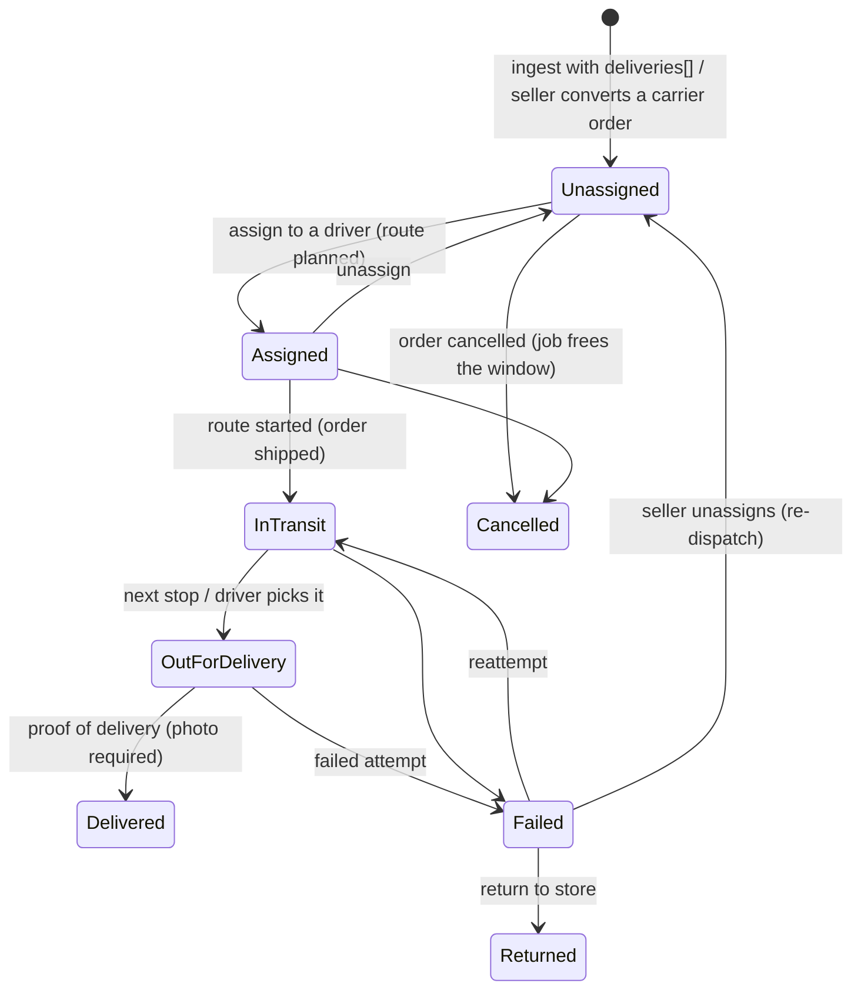

# Local delivery with the seller's own drivers (workstream L)

A **second delivery method next to carriers**: the seller delivers some packages with their own drivers, with the same tracking as a carrier shipment.
Code: `src/Solvelt.Api/Delivery/**`, entities `Domain/LocalDelivery.cs`, one EF migration `LocalDelivery`, tests `tests/Solvelt.Api.Tests/Delivery*Tests.cs`.
Decisions: `docs/DECISIONS.md` (section L). Brief: `docs/agent-briefs/L-local-delivery.md`.

## 1. Flows

```mermaid
sequenceDiagram
    participant B as Buyer / marketplace
    participant P as Portal (this API)
    participant S as Seller (dispatch board)
    participant D as Driver (/driver PWA)
    B->>P: POST /api/internal/v1/local-delivery/eligibility (signed)
    P-->>B: eligible, fee, open windows (remaining capacity)
    B->>P: POST /api/internal/v1/orders with deliveries[] (window books capacity atomically)
    P-->>S: new order (shippingMethod "local"); seller accepts
    S->>P: assign to a driver (route per driver and day), optimize order
    P-->>B: order.tracking_updated pre_transit
    D->>P: start route (order Shipped, shipment method local)
    P-->>B: in_transit, then out_for_delivery for the next stop
    D->>P: location pings (consented, only while active)
    P-->>B: order.tracking_updated with ETA (+ coarse position for the next stop only)
    alt delivered
        D->>P: photo (+signature, recipient, placement) then "delivered" event
        P-->>B: shipment.delivered with signed proof URLs; order -> Delivered (payments release as usual)
    else failed attempt
        D->>P: failed (reason, note, photo)
        P-->>B: delivery.attempt_failed; seller alerted
        D->>P: reattempt or return_to_store
    end
```



## 2. Status mapping (shared with K's normalized tracking statuses)

| Local status | Normalized `status` | Notes |
|---|---|---|
| Assigned | `pre_transit` | event `order.tracking_updated` |
| InTransit | `in_transit` | route started; the order is shipped through the normal ship flow (stock committed, `order.shipped` event, SLA) with carrier `Local`, tracking number = delivery code `LD-XXXXXXXXXX`, shipment `method: "local"` |
| OutForDelivery | `out_for_delivery` | exactly one stop per route is "next" |
| Delivered | `delivered` | order moves to Delivered through `MarkDeliveredAsync`: the payments release timing is unchanged |
| Failed | `failure` | order stays Shipped, seller alerted; `delivery.attempt_failed` |
| Returned | `return_to_sender` | seller refunds or re-dispatches (order stays Shipped; the existing refund flow applies) |

Shared pieces added additively for K (rebase onto K's work when it lands, no duplicate models): `Shipment.Method` (`carrier` default | `local`), `Shipment.TrackingStatus/TrackingStatusAt/Eta`, `TrackingEvent` (history per order/shipment, optional unique `SourceEventId`), `TrackingStatus` constants.

## 3. Data model

| Entity | Purpose |
|---|---|
| `DeliverySetting` | Per account (or per brand, which overrides): enabled, time zone, same-day cutoff, lead minutes, days ahead. `Version` concurrency token. |
| `DeliveryZone` | Radius from an origin and/or postcodes (`112*` prefix) and/or polygon; fee, free-over threshold, minimum order, priority. |
| `DeliveryWindow` | Local start/end minutes, capacity, weekday mask. A window with bookings is deactivated instead of deleted. |
| `DeliveryWindowUsage` | (window, local date) -> booked. Booked with a conditional `UPDATE ... WHERE Booked < capacity` (first booking: `INSERT ... ON CONFLICT DO NOTHING`), so parallel bookings never overbook on SQLite or PostgreSQL. |
| `LocalDelivery` | One per order: window (UTC), fee, destination coordinates, status, route/stop, driver, attempts, ETA, `Version`, `LastEventClientAt`. |
| `DeliveryRoute` | One per (account, day, driver) while planned/active. |
| `DeliveryAttempt`, `DeliveryProof` | Attempt outcome/reason/recipient/placement; proof photo or signature (bytes in `IFileStorage`, metadata stripped). |
| `DeliveryClientEvent` | Primary key = client event id: idempotency and audit of every driver event. |
| `DriverLocation`, `DriverConsent` | Coarse positions with a 24 h expiry; the driver's consent and pause flag. |
| `TrackingEvent` | Tracking history with the normalized statuses. |

## 4. Marketplace contract

All under `/api/internal/v1` (HMAC signing as in `docs/ORDERS.md`).

**Eligibility and windows** - `POST /local-delivery/eligibility`
```json
{ "sellerId": "…", "brandId": "…", "subtotalCents": 2000, "address": { "postalCode": "11201", "country": "US", "lat": 40.6928, "lng": -73.9903 } }
```
```json
{ "eligible": true, "reason": null, "method": "local", "feeCents": 500, "zone": { "id": "…", "name": "Brooklyn" }, "timeZone": "America/New_York",
  "windows": [ { "windowId": "…", "date": "2026-11-04", "start": "2026-11-04T17:00:00Z", "end": "2026-11-04T19:00:00Z", "remaining": 2 } ] }
```
`reason` when not eligible: `not_offered`, `outside_zone`, `below_minimum`. Only windows with remaining capacity are listed; same-day windows respect the cutoff and the lead time. The quote does not reserve capacity.

**Order ingest** (additive fields on `POST /orders`): `shippingAddress.lat/lng` (optional) and
```json
"deliveries": [ { "sellerId": "…", "brandId": "…", "method": "local", "windowId": "…", "date": "2026-11-04" } ]
```
The zone and window are checked again and capacity is booked atomically; the whole order is rejected (`422 invalid_order`, nothing created, stock released) with `errors[].code` of `delivery_outside_zone`, `delivery_below_minimum`, `delivery_window_unavailable`, `delivery_window_full` or `delivery`. The marketplace charges the buyer; the fee quoted is stored on the delivery, the buyer paid amount is the order's shipping amount (no ledger change).

**Outbox events** (envelope as in `docs/ORDERS.md`)
```json
{ "type": "order.tracking_updated", "data": { "order": { "sellerOrderId": "…", "marketplaceOrderId": "MP-1" }, "shipmentId": "…", "method": "local", "carrier": "Local",
  "trackingNumber": "LD-8F3A1C09BE", "status": "out_for_delivery", "statusDetail": "On the way",
  "eta": { "windowStart": "…", "windowEnd": "…", "estimatedAt": "2026-11-04T12:41:00Z" }, "driverFirstName": "Sam",
  "position": { "lat": 40.693, "lng": -73.99 }, "occurredAt": "…" } }
```
`position` is present **only** on events for the stop that is next (`out_for_delivery`), rounded to 3 decimals (~100 m), at most one per minute. `driverFirstName` is the first name only (the first letters of the e-mail local part).

`shipment.delivered`: `{ order, shipmentId, method:"local", deliveredAt, placement, recipientName, proof: { photoUrls:[…], signatureUrl, expiresInMinutes: 60 } }` - the URLs are `/api/public/delivery-proof/{id}?exp=…&sig=…` (HMAC with the outbound secret, valid `LocalDelivery:ProofUrlMinutes`, default 60; prefix with the portal API origin).
`delivery.attempt_failed`: `{ order, shipmentId, method:"local", attempt, reason, occurredAt }` (`no_one_home | address_issue | refused | unsafe`; the free-text note stays in the portal).
`order.delivery_method_changed`: `{ order, method:"local", deliveryCode, window, feeCents }` when the seller switches a carrier order to local (audited, timeline event).
Delivered also sends the usual `order.delivered`, and starting the route sends `order.shipped` (carrier `Local`).

## 5. Seller API (`/api/v1`)

| Endpoint | Permission |
|---|---|
| `GET/PUT seller/delivery/settings?brandId=` (zones, fees, windows, cutoff; PUT replaces, `version` checked) | read: `DeliveryRead`; write: `DeliverySettings` (Owner/Admin) |
| `GET seller/delivery/board?date=`, `GET seller/delivery/drivers`, `GET seller/delivery/routes/{id}` (printable sheet) | `DeliveryRead` (brand scope applies) |
| `POST seller/delivery/deliveries/{id}/assign|unassign`, `POST seller/delivery/routes` (create + optional `optimize`), `…/routes/{id}/optimize|reorder|reassign` | `DeliveryDispatch` (Owner/Admin/Manager for their brands) |
| `POST seller/orders/{id}/local-delivery` (convert a carrier order) | `DeliveryDispatch` |
| `GET seller/orders/{id}/tracking` (timeline, attempts, proof links) | `BrandWorkRead` |
| `GET seller/delivery/proofs/{id}` (authorised file) | `DeliveryRead` |

Route optimization is `IRouteOptimizer`; the built-in implementation is nearest-neighbour on straight-line distance (stops without coordinates go last). A routing provider (ROADMAP) replaces it through DI.

## 6. Driver role and app

Driver is a team role (`AccountRole.Driver`, numerically below Viewer) invited through the normal invitation flow. Its only permission is `DeliveryDrive`. **Default deny:** `DriverGuard` (a middleware after authentication) answers `403 driver_forbidden` for every path except `/api/v1/driver`, sign-in/session/security endpoints and `team/leave`. Owner/Admin/Manager can use the driver app too, for their own routes. Drivers see only stops of routes assigned to them (anything else is `404`).

Driver endpoints (`/api/v1/driver`): `GET me`, `GET stops/{id}`, `POST routes/{id}/start`, `POST stops/{id}/proofs` (multipart `file`, `kind` photo|signature, `clientId`), `POST stops/{id}/events`, `POST consent`, `POST location`.

* **Visibility:** address, buyer first name and phone are returned only while the route is planned/active **and** the stop is open. **Known deviation (ROADMAP: needs a relay number):** the phone is the buyer's real delivery phone, there is no relay number (Assigned, InTransit, OutForDelivery, Failed). After the stop is delivered/returned or the route completes they are gone. The buyer's e-mail is never shown; contact is the first name plus the delivery phone the marketplace supplied (`tel:`/`sms:` links); "Navigate" is a maps URL.
* **Events:** `out_for_delivery`, `delivered` (needs `placement` `left_at_door|handed_to` and at least one photo proof; recipient name and signature optional), `failed` (reason required; note and photo optional), `reattempt`, `return_to_store`.
* **Offline queue:** the app stores uploads and events locally and replays them in order. `clientAt` is clamped to `[max(route start, shipment ShippedAt), now + 5 min]`, so a forged or very old date cannot back-date a delivery. A client that gets 401/403 (session) pauses and keeps everything; a `409 version_conflict` is resent with the same id after a backoff; only validation-style refusals are final. `clientEventId` is unique: a replay (also in parallel) is applied once and answers `replayed: true`. An event older than the newest applied one for that stop (`clientAt`) is recorded as `ignored_stale` and changes nothing; an event for a finished stop is `ignored_state`. A client clock more than 5 minutes ahead is clamped. A rejected event (validation, wrong state) leaves no trace, so the corrected one can reuse its id. Route and stop rows use optimistic concurrency (`409 version_conflict`).
* **Route lifecycle:** the route completes when no stop is Assigned/InTransit/OutForDelivery/Failed; the seller gets "route finished".

## 7. Live ETA and location privacy

* Sharing starts only after the driver **consents** in the app (`POST consent`), can be **paused** at any time, and is only accepted while the driver's route is **active**.
* Positions are rounded to ~100 m (3 decimals) **before** storage, kept at most **24 hours** (`LocalDelivery:LocationRetentionHours`, deleted by the maintenance job), and deleted immediately when the driver pauses or withdraws consent.
* The server computes a rough ETA per remaining stop (straight line at 30 km/h plus 4 minutes per earlier stop). The buyer-facing event carries the ETA, and a coarse position **only when the buyer's stop is next**.
* Positions are never written to logs or audit trails; the copy inside stored `order.tracking_updated` outbox rows is blanked after the same retention period; the seller dashboard shows the stop ETA, not a live map (ROADMAP).
* The only precise point stored is the delivery location the driver's device reports with the delivered event (4 decimals, ~10 m), as part of the proof of delivery.

## 8. Proof of delivery media

Photos and signatures are accepted as JPEG/PNG only (magic bytes, not the client's content type), max 8 MB, and **EXIF/XMP/IPTC/text metadata is stripped** before they are stored through `IFileStorage`. They are served `nosniff`, `Cache-Control: private, no-store`, only through the authorised seller endpoint (brand scope; drivers get 403) or a short-lived signed URL. They are deleted when the order's buyer data is redacted (retention job), which also nulls the order's and delivery's coordinates and the attempts' recipient name, note and coordinates.

## 9. Notifications

Seller in-app (SSE) event and e-mail (Owners/Admins by role default) for a failed attempt, a delivery returned to the store, a delivery late against its window (once), and a route finished. The marketplace sends the buyer's texts and e-mails from the outbox events.

## 10. Staff tools (read-only)

`GET /api/v1/admin/sellers/{id}/local-delivery` (`DeliveryView`, all staff roles): settings, routes, deliveries - no addresses or names. `POST /api/v1/admin/local-delivery/deliveries/{id}/proof-access` (`LookupsReveal` + reason, rate limited like the PII reveal): audited as `admin.delivery.proof_viewed` before returning 60-minute signed proof links, attempts and recipient.

## 11. Going-live checklist

1. Settings -> Shipping -> Local delivery: enable, set the time zone, zones (radius origin or postcodes), fees, windows with capacity and the same-day cutoff.
2. Invite drivers (Team -> role **Driver**); each driver signs in on their phone, opens `/driver` and adds it to the home screen.
3. The marketplace calls the eligibility endpoint at checkout and sends `deliveries[]` + `shippingAddress.lat/lng` on order ingest.
4. The marketplace tracking page and notifications consume `order.tracking_updated` (with `method: "local"`), `shipment.delivered` (fetch the proof URLs within the hour), `delivery.attempt_failed`.
5. **Set `LocalDelivery:ProofUrlKey`** (a long random secret, different from the Orders secrets): it signs the proof-of-delivery links and the app refuses to start in production without it.
6. Optional: a routing provider behind `IRouteOptimizer`; `LocalDelivery:*` options (`ProofUrlMinutes`, `LocationRetentionHours`, `EtaEventSeconds`).
7. Production: `LocalDelivery` maintenance runs as a hosted worker every minute (retention, late alerts, cancelled orders, proof cleanup).

## 12. Not verified / limits

No real routing provider, no real phones or GPS (positions are posted by tests); coordinates come from the marketplace (no geocoder here); a local delivery covers the whole unshipped order (partly shipped orders are not eligible); the PostgreSQL path of the capacity insert is not covered by an automated test (SQLite is).
