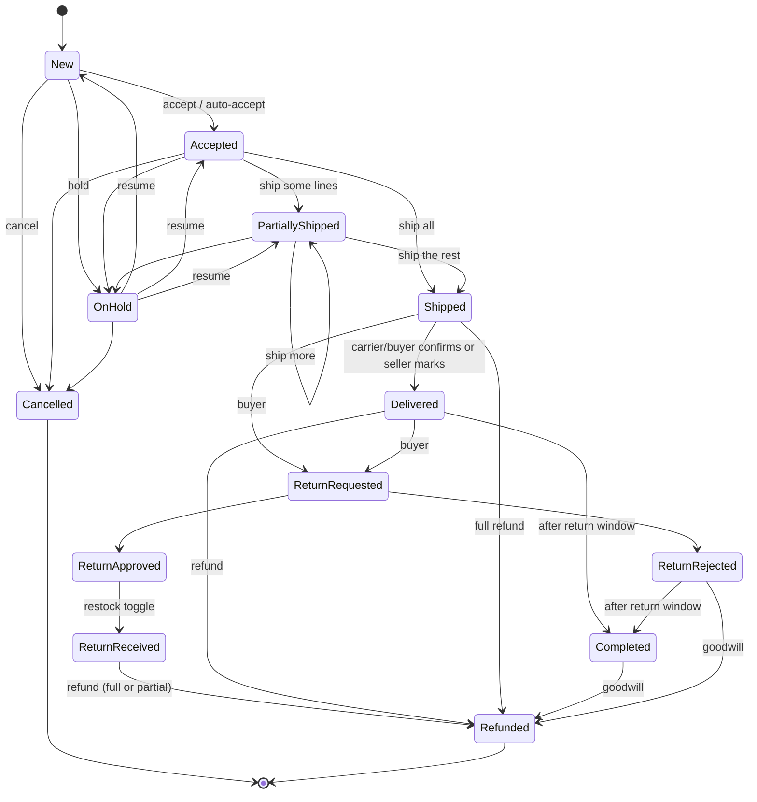

# Seller orders, marketplace integration and buyer messaging (workstream E)

Buyers order on the main Solvelt website (a separate system). Orders arrive here through a **signed internal API**; sellers see, manage and fulfil
them in the portal; every seller-side change goes back to the marketplace through a **transactional outbox** (signed webhook). Money movement
(charging, refunds) is done by the marketplace; the portal records seller decisions and amounts, keeps the seller ledger and moves released funds to the seller's Stripe account (`docs/PAYMENTS.md`: the marketplace reports `payment.captured`, `refund.processed` and `dispute.*` to `/api/internal/v1/payment-events`). For a marketplace order with several seller orders, `dispute.*` is sent once per seller order with `sellerOrderNumber` and that seller order's share (see *Disputes on multi-seller orders* in `docs/PAYMENTS.md`).

Code: `src/Solvelt.Api/Orders/**`, entities `Domain/Orders.cs`, one EF migration `Orders`. Tests: `tests/Solvelt.Api.Tests/Order*Tests.cs`.

## 1. Data model

| Entity | Purpose |
|---|---|
| `SellerOrder` | One per **(seller account, brand)**. Number `SO-2026-000123` (per-year counter, compare-and-swap, unique), `MarketplaceOrderId`, status, buyer display name + relay email + optional carrier phone, shipping address, method/speed, ship-by and deliver-by dates, gift message, money (cents), flags `Oversold`, `CancelRequested`, `ShippedLate`, `Version` (optimistic concurrency). |
| `OrderLine` | Product/variant ids + **snapshot** of title, SKU, options text, image key, unit price, quantity, discount, tax; `ShippedQty`, `CancelledQty`, `RefundedQty`, `ReturnedQty`, `ReservedQty` (units currently held in stock). |
| `Shipment` / `ShipmentLine` | Carrier, service, tracking number, shipped-at, delivered-at, lines + quantities (partial shipments). |
| `OrderCancellation` | Buyer request or seller decision, reason, note, restock, status (Requested / Approved / Rejected). |
| `ReturnRequest` / `ReturnLine` | Buyer return: lines, reason, comment, status (Requested / Approved / Rejected / Received / Refunded), refund amount, restock. |
| `OrderRefund` / `RefundLine` | Full or partial refund: per-line amounts + shipping, reason, optional link to a return. |
| `OrderNote` | Internal note (team only). `OrderEvent` | Timeline (placed, accepted, shipped, ...). |
| `OutboxMessage` | Transactional outbox (Pending / Delivered / Dead). `InboundNonce` | Replay table of the signed API. |
| `Conversation` / `OrderMessage` / `MessageAttachment` / `ConversationRead` / `ConversationNote` / `MessageTemplate` | Messaging (section 6). |
| `NotificationPreference` | Per user + account email opt-ins (null = role default: Owner/Admin on, Manager/Viewer off). |

**Money** is `long` cents everywhere; no floating point. `Total = items - discounts + shipping + tax + shippingTax` (what the buyer paid; `tax` is the sum of the lines' `taxCents`,
`shippingTax` the group's `shipping[].taxCents`);
`Fee = round-half-up((items - discounts) x Orders:FeeBasisPoints / 10000)` (default 10%); `Net = items - discounts + shipping - fee`
(neither kind of tax is in the fee base or in the net: the marketplace remits them; shipping tax is **not** in `net`, shipping is). Partial refunds prorate a line by quantity and the **last unit takes the rounding remainder**, so the sum of
refunds never exceeds what was paid.

## 2. Status state machine

One place (`OrderStateMachine`) knows the legal transitions; the API answers **409** with a plain message for anything else.



Rules enforced on top of the diagram: shipping needs Accepted/PartiallyShipped and no open buyer cancellation request; a **fully shipped order cannot be cancelled**, but the **unshipped remainder of a partly shipped order can** (`POST .../cancel`): its stock is released (or consumed without restock), the refund for those units is recorded (`reason cancelled_remainder`, an `OrderRefund` row like a full cancel; any role allowed to cancel may do it, it does not need the refund permission), an `order.cancelled` event with `partial:true` and `refundDueCents` goes out, and the order continues as Shipped; **refunds only cover units that have shipped** (nothing shipped yet -> `409 refund_before_ship`, cancel instead; the full refund of a partly shipped order covers the shipped units + shipping); a partial refund of a delivered order keeps its status until the order is fully
refunded; refunds after a received return move the order to Refunded (the refund amount tells partial from full); cancelled orders are refunded
in full by the marketplace (`refundDueCents` is in the `order.cancelled` event).

**Stock effects** (through `IInventoryService`, atomic single-statement updates): ingest = `Reserve` (never fails the order; a shortage flags it
**Oversold - needs attention** and reserves nothing for that line); ship = `Commit` the shipped units; cancel with restock = `Release`, without restock
(damaged/lost) = `Commit` (units leave on-hand stock); return received with restock = `Adjust(+qty)`. Every action first **claims** the order with an
atomic version bump inside a transaction that also carries the stock changes and the final save, so two concurrent actions can never both apply
their side effects (`409 version_conflict` for the loser; `version` in the request body is optional and checked too).

**SLA:** `ShipByAt = placedAt + max(product handling days, Orders:DefaultHandlingDays (2))` calendar days; `DeliverByAt = ShipByAt + transit`
(standard 5, expedited 2, overnight 1). *Late* = unshipped past ship-by (computed, not stored). The dashboard shows today's orders, to-ship, late,
open returns, 30-day sales (daily series), **late-shipment rate** and **cancellation rate** (30 days), plus message metrics.

**Stock repair:** units that ship without ever having been reserved (oversold) are deducted from on-hand stock as far as the stock still reserved for other orders allows; any shortfall adds a `stock.mismatch` timeline event (`stockMismatch:true` in the order detail) and an audit entry. A **reservation reconciler** sets `Reserved` back to the sum of open order lines' `ReservedQty` when a hold leaked (crash between reserve and save, failed release), but never for holds of ingests running in this process right now (`InflightHolds`, announced before the stock moves) and only after the same difference was seen for 2 minutes (covers another instance's in-flight holds). **Operational limit:** `InflightHolds` is per process, so with several instances a hold of an ingest stalled for more than `ReservationDrift.Grace` (2 min) on ANOTHER instance could still be repaired away: keep request deadlines on the internal API well under 2 minutes (or move the in-flight markers to the database later). A `Commit` that fails when an order ships is flagged as `stock.mismatch` too.

**Jobs** (`OrderMaintenance`, hosted worker every 10 s outside Testing, `POST /api/dev/maintenance/run` in Dev/Testing): auto-accept
(`Orders:AutoAcceptMinutes`, 0 = off), Delivered -> Completed after `Orders:ReturnWindowDays` (30), PII redaction, overdue-reply notices, replay-table cleanup.

## 3. Integration contract (main website <-> portal)

> Service bookings and quotes use the same signing and outbox; their contract is in `docs/SERVICES.md`. Note for the marketplace (C13): `POST /quotes/{id}/accept` now returns a **hold** (`status: Hold`, `holdExpiresAt`); take payment, then call `POST /bookings/{mid}/confirm` to make it `Confirmed` (`booking.confirmed` is sent then, not at accept). A lapsed hold sends `booking.hold_expired` and reopens the quote.

### 3.1 Signing (inbound: marketplace -> portal)
Base path `/api/internal/v1`. Every request carries:

| Header | Value |
|---|---|
| `X-Solvelt-Timestamp` | Unix seconds. Rejected if more than `Orders:TimestampWindowSeconds` (300) from the server clock (`stale`). |
| `X-Solvelt-Nonce` | Random string (<= 100 chars), **unique per request**. Reuse -> `401 replayed` (stored until its window has passed). |
| `X-Solvelt-Signature` | `v1=` + lower-case hex `HMAC-SHA256(secret, canonical)` |

`canonical` = five lines joined by `\n`: `timestamp`, `nonce`, upper-case `METHOD`, the **encoded path + query exactly as sent**, and the lower-case hex
SHA-256 of the **exact body bytes** (empty body for GET). The secret is `Orders:InboundSecret` (env `Orders__InboundSecret`); it is **never** the
outbound secret (start-up fails if they are equal, or missing outside Development/Testing). The signature is checked before the nonce is stored, so
strangers cannot fill the replay table; bodies larger than `Orders:MaxInboundBodyBytes` (256 KB) get `413`. Seller bearer tokens are ignored here
and a signature opens nothing under `/api/v1`. Unsigned/wrong/stale/replayed -> `401` with `code` = `unsigned | bad_timestamp | stale | bad_signature | replayed`.

A timestamp outside 0..year 2100 is `401 bad_timestamp` before any arithmetic. **Test vector** (also a unit test): secret `test-secret`, timestamp `1700000000`, nonce `abc123`, `POST /api/internal/v1/orders`, body `{"a":1}` ->
body hash `015abd7f5cc57a2dd94b7590f04ad8084273905ee33ec5cebeae62276a97f862`, signature `v1=8a1a05a14201d38431d0c9816b6b127ff9193117e81e0530895a25934cbaadea`.

```bash
# scripts/post-signed.sh does exactly this with openssl + curl
ORDERS_INBOUND_SECRET=... scripts/post-signed.sh POST /api/internal/v1/orders order.json https://api.example.com
```
```
POST /api/internal/v1/orders HTTP/1.1
X-Solvelt-Timestamp: 1767225600
X-Solvelt-Nonce: 5b0e0f2c7a1d4e0f9a3c1d2e3f405162
X-Solvelt-Signature: v1=<hex hmac of the canonical string>
Content-Type: application/json
```

### 3.2 Create order - `POST /orders`  (idempotent on `marketplaceOrderId`)
```json
{
  "marketplaceOrderId": "MP-10045", "placedAt": "2026-01-15T10:30:00Z", "currency": "USD",
  "buyer": { "displayName": "Jane B.", "relayEmail": "relay-8f3a@relay.solvelt.example", "phone": "+1 555 000 1111" },
  "shippingAddress": { "name": "Jane Buyer", "line1": "1 Main St", "line2": "Apt 2", "city": "Brooklyn", "region": "NY", "postalCode": "11201", "country": "US" },
  "shippingMethod": "Standard", "shippingSpeed": "standard", "giftMessage": null,
  "lines": [
    { "marketplaceLineId": "L-1", "sellerId": "<account guid>", "brandId": "<brand guid>", "productId": "<guid>", "variantId": null,
      "quantity": 2, "unitPriceCents": 1999, "discountCents": 0, "taxCents": 320 },
    { "marketplaceLineId": "L-2", "sellerId": "<account guid>", "brandId": "<other brand guid>", "sku": "MUG-BLUE-L", "quantity": 1, "unitPriceCents": 2500 }
  ],
  "shipping": [ { "sellerId": "<account guid>", "brandId": "<brand guid>", "amountCents": 599, "taxCents": 45, "speed": "overnight", "method": "Next-day air" },
                { "sellerId": "<account guid>", "brandId": "<other brand guid>", "amountCents": 300 } ]
}
```
* A line names its product by `productId` (+ `variantId` when the product has variants) **or** by `sku` (product or variant SKU of that account).
* **Splitting:** one `SellerOrder` per distinct (sellerId, brandId); shipping charged is per group via `shipping[]`.
* **Speed and method per group (C8a):** a `shipping[]` entry may carry `speed` (`standard`|`expedited`|`overnight`) and `method` (a label of 1 to 64 characters, the width of the stored column; control characters are removed). When present they replace the order-level `shippingSpeed` / `shippingMethod` **for that group's seller order only**: its `DeliverByAt` (handling days + 5 / 2 / 1 transit days), the packing slip (`shippingSpeed`, `shippingMethod`, `deliverByAt`) and the order detail. Without them the order-level fields apply, as before (in the example above the second group is standard / "Standard"). An unknown speed, or a method that is empty after cleaning or longer than 64 characters (the order-level `shippingMethod` too), is `422` (`shipping.speed` / `shipping.method`) and nothing is created. At most 50 `shipping[]` entries are accepted, and a group's summed amount and summed tax must each stay within 10,000,000.00 (`422` otherwise). If the same group appears twice, the amounts and taxes add up and the entries must not disagree on speed or method (`422` otherwise).
* **Tax on shipping (C8b):** `shipping[].taxCents` (integer >= 0, minor units of the order currency, optional, 0 when absent; `422` if negative or if the group's shipping amount is 0). It is part of the seller order's `Total` and `refundableCents`, it is **not** in the fee base or the net, and it is shown as `shippingTaxCents` in the order detail's `money`, on the packing slip (`shipping: {shippingCents, shippingTaxCents}`, hidden on gift orders like every price) and as an information-only `shippingTaxCents` per currency in the payments monthly statement (never in a balance: tax does not enter the ledger). A replay with the same `marketplaceOrderId` is a no-op even when these fields differ: the first order stands (`200 {created:false}`).
* **Validation (all-or-nothing):** the seller must be Approved/active; the brand must belong to the account; the product/variant must belong to that account **and brand** and be **Active** (variants Enabled). Money fields are capped (unit price/shipping <= 1,000,000,000 cents; discount/tax proportionally). Any bad line -> `422 invalid_order` with `errors:[{index, code, message}]` (`product`, `brand`, `seller`, `sku`, `variant`, `product_inactive`, `not_a_product` (the listing is a service: "Services are booked, not ordered"), `variant_inactive`, `quantity`, `amount`, ...) and **nothing is created or reserved**.
* **Response** `201 {created:true, orders:[{sellerOrderId, number, sellerId, brandId, status, oversold, totalCents, feeCents, netCents}]}`; the same `marketplaceOrderId` again -> `200 {created:false, ...}` with the original orders (also when two deliveries race).
* Stock short -> still `201`, `oversold:true`.

### 3.3 Buyer events
| Endpoint | Body | Notes |
|---|---|---|
| `POST /orders/{marketplaceOrderId}/cancel-requests` | `{requestId, reason, note?, sellerOrderNumber?}` | `reason` in `changed_mind, ordered_by_mistake, found_better_price, delivery_too_slow, other`. Applies to every seller order of that marketplace order unless `sellerOrderNumber` is given. Per-order result `requested | duplicate | already_cancelled | auto_rejected` (shipped orders are declined automatically and an outbox `cancellation.decided` is sent). Idempotent on `requestId`. If the order changed at the same instant the answer is **`503` + `Retry-After: 1`** with `code: version_conflict` and the per-order results (`retry` = not stored): send the same request again. |
| `POST /orders/{marketplaceOrderId}/return-requests` | `{returnId, reason, comment?, sellerOrderNumber?, lines:[{marketplaceLineId, quantity}]}` | `reason` in `damaged, not_as_described, wrong_item, no_longer_needed, other`. Quantity <= shipped - returned - refunded. Idempotent on `returnId`; result per order `requested | duplicate | rejected(message)`. |
| `POST /orders/{marketplaceOrderId}/delivery-confirmations` | `{sellerOrderNumber?, trackingNumber?, deliveredAt?}` | Shipped -> Delivered; with `trackingNumber` on a partially shipped order only that shipment is marked. Idempotent. |
| `POST /messages` | `{messageId, conversationId, kind:"order"\|"product", marketplaceOrderId?, sellerOrderNumber?, productId?, buyerName, text, sentAt?}` | See section 6. Idempotent on `messageId` (`200 duplicate`). |
| `POST /messages/{messageId}/reports` | `{reason?}` | Buyer reported a message: conversation flagged for admin review. |
| `POST /messages/{messageId}/receipts` | `{status:"delivered"\|"read"\|"failed"}` | `messageId` = the id from the `message.sent` event; status only moves forward. |
| `GET /attachments/{id}` | - | Signed GET (empty body) to download a seller attachment listed in a `message.sent` event. |

### 3.4 Outbound webhook (portal -> marketplace)
Every seller-side change is written to `outbox_messages` **in the same SaveChanges/transaction** as the state change (a rejected action writes nothing),
then delivered by the dispatcher to `Orders:WebhookUrl`:
```
POST <WebhookUrl>
X-Solvelt-Timestamp: <unix seconds>
X-Solvelt-Event-Id: <outbox id>          # NOT signed, informational: the signed body's `id` is the event id; use that for idempotency (events may be delivered more than once)
X-Solvelt-Event-Type: order.shipped
X-Solvelt-Signature: v1=HMAC-SHA256(Orders:OutboundSecret, "<timestamp>.<raw body>")
{ "id": "<event id>", "type": "order.shipped", "createdAt": "...", "data": { ... } }
```
Respond `2xx` to acknowledge. Each message is **leased** (`LockedUntil`, atomic UPDATE) before sending, so several portal instances never send the same event twice; delivery is still *at least once*, so dedupe on the signed body `id` (for `listing.upserted` / `listing.unlisted` the listing's `version` is the natural key as well). The `X-Solvelt-Event-Id` header is not covered by the signature. Anything else (or a network error) is retried with **exponential backoff** `Orders:OutboxBackoffSeconds x 2^(attempt-1)`
(default 30 s, 60 s, 120 s ... capped at 1 h) up to `Orders:OutboxMaxAttempts` (8); then the message is **Dead** (visible at
`GET /api/v1/admin/outbox?status=dead`, re-queued with `POST /api/v1/admin/outbox/{id}/retry`). With no `WebhookUrl`, Development/Testing deliver to an
in-memory **dev sink** (`GET /api/dev/outbox` shows body, timestamp and signature); Production keeps events pending.

**Ordering (C14).** The events of **one seller order** (`order.*`, `refund.issued`, `shipment.*`, `return.*`, `delivery.*`, `cancellation.decided`) and of **one booking** (`booking.*`) are delivered **in the order they were written**: each gets the next sequence number of its seller order / booking (`outbox_messages.SequenceScope` + `OrderKey`, assigned in the transaction that records the change) and the dispatcher never sends one while an older event of the same seller order / booking is pending, being sent or waiting for a retry. Events of different seller orders (and of different bookings) are independent and flow in parallel; there is no global blocking.
**A Dead predecessor does not block its successors forever.** When an older event of the same seller order / booking is **Dead** (it exhausted its attempts and never reached the marketplace), the later events are sent and carry `"predecessorDead": true` at the top level of the signed body (next to `id`, `type`, `createdAt`, `data`; the stored payload does not have it, it is added when sending). It stays on every later event of that seller order until the Dead one is re-queued (`POST /api/v1/admin/outbox/{id}/retry`) and delivered: treat it as "your view of this order has a gap; reconcile". A re-queued event is sent late, after its successors (events are never dropped as superseded: every event is information), so **still dedupe on the signed body `id`** and do not assume a strictly increasing delivery after a re-queue. Events written before the ordering existed have no sequence and are not ordered.

**`order.cancelled` and the refunds it nets out (C14).** `refundDueCents` already subtracts refunds recorded earlier, so the event names them: `refundIdsAccounted: [refundId, ...]` (the `refundId` of each `refund.issued` already recorded on that seller order when the cancel happened) and `previouslyRefundedCents` (their sum, including tax and shipping). For a partial (remainder) cancel it lists the refunds recorded so far too, not the remainder's own refund (that is `refundDueCents`). Both are `[]` / `0` when nothing was refunded before.

**Signature scope:** the webhook signature is an HMAC over `<timestamp>.<raw body>` only. The `X-Solvelt-Event-Id` and `X-Solvelt-Event-Type` headers are **not** signed: take the event id and type from the signed body (`id`, `type`), never from the headers (use the headers for routing hints at most). A future signature version v2 is planned over `<ts>.<event id>.<event type>.<body>` (see `docs/ROADMAP.md`).

`data.order` is always `{sellerOrderId, sellerOrderNumber, marketplaceOrderId}` on the order events; the catalog and moderation events `listing.*` and `content.report_decided` (`docs/CATALOG.md`) are not about an order and carry none.

| Event | Extra `data` fields |
|---|---|
| `order.accepted` | `acceptedAt`, `auto` |
| `order.held` / `order.resumed` | `note` / `status` |
| `order.shipped` | `partial`, `shipmentId`, `carrier`, `service`, `trackingNumber`, `trackingUrl`, `shippedAt`, `lines:[{marketplaceLineId, sku, quantity}]` |
| `order.tracking_updated` | `shipmentId`, `carrier`, `trackingNumber`, `trackingUrl` |
| `order.delivered` | `deliveredAt`, `by` (`seller`/`buyer`) |
| `order.cancelled` | `reason`, `note`, `restocked`, `cancelledBy`, `refundDueCents` (the marketplace refunds this), `taxCents` (the tax inside `refundDueCents`), `shippingTaxCents`, `partial` + `lines:[{marketplaceLineId, quantity, amountCents, taxCents}]` when only the unshipped remainder was cancelled (see "Money in events") |
| `cancellation.decided` | `requestId`, `decision` (`rejected`), `note` (approval is `order.cancelled`) |
| `return.decided` | `returnId`, `decision` (`approved`/`rejected`), `reason`, `note` |
| `return.received` | `returnId`, `restocked` |
| `refund.issued` | `refundId`, `amountCents`, `shippingCents`, `shippingTaxCents`, `taxCents`, `currency`, `reason`, `note`, `full`, `totalRefundedCents`, `returnId`, `lines:[{marketplaceLineId, sku, quantity, amountCents, taxCents}]` (see "Money in events"). **The marketplace moves the money.** |
| `listing.upserted` | `listingId`, `version` (catalog feed; see `docs/CATALOG.md`; delivered in version order per listing) |
| `listing.unlisted` | `listingId`, `version`, `reason` (`not_active`, `archived`, `seller_suspended`, `moderated`, `brand_removed`, `deleted`) |
| `content.report_decided` | `reportId`, `kind` (`review`/`listing`/`message`), `targetId`, `decision` (`dismissed`/`hidden`/`removed`), `reasonShownToUser` (nullable) (`docs/CATALOG.md`, `docs/ADMIN.md`) |
| `message.sent` | `messageId`, `conversationId`, `marketplaceConversationId`, `kind`, `marketplaceOrderId`, `sellerOrderNumber`, `productId`, `text`, `sentAt`, `attachments:[{id, fileName, contentType, size, path}]` |

#### Money in events

Which amounts include tax (all `long` minor units of the order currency):

* **`refund.issued.amountCents` = the TOTAL to give the buyer back** = the lines refunded **including their tax** + `shippingCents` + `shippingTaxCents`.
  `shippingCents` is the shipping refund **net of tax**; `shippingTaxCents` is the shipping tax refunded; `taxCents` is **all the tax inside `amountCents`** = sum of `lines[].taxCents` + `shippingTaxCents`.
  `lines[].amountCents` includes that line's tax; `lines[].taxCents` is the tax inside it.
* **Proration** (same rule for amounts and tax, so the shares of all refunds add up to exactly what was charged): a line's tax share is `floor(lineTax x quantity / lineQuantity)` and the **last refund of the line takes the remainder**; the shipping tax of a shipping refund is `floor(shippingTax x shippingRefunded / shipping)` and the **refund that completes the group's shipping takes the remainder**.
  Worked example (a test): shipping 500 with shipping tax 45, no lines. A 40 % shipping refund (200) gives `amountCents 218, shippingCents 200, shippingTaxCents 18, taxCents 18`; a second refund of the remaining 300 gives `amountCents 327, shippingCents 300, shippingTaxCents 27, taxCents 27` (18 + 27 = 45). A line of 3 units with tax 100 refunded one unit at a time carries tax 33, 33, 34.
* **`order.cancelled.refundDueCents`**: for a full cancel `total - refunded` (items + line tax + shipping + shipping tax); `taxCents` = the line tax + `shippingTaxCents` inside it, and `shippingTaxCents` is the shipping tax. For a **partial** (unshipped remainder) cancel `refundDueCents` = the cancelled lines including their tax, **without shipping**: `shippingTaxCents` is 0, `taxCents` = the tax of those lines, and `lines[].taxCents` gives it per line.
* **`refund.processed` (marketplace -> portal) is unchanged: tax never enters the ledger.** Its `amountCents` is the items **excluding tax**, `shippingCents` the shipping excluding tax. From a `refund.issued` the marketplace sends `amountCents - taxCents - shippingCents` (`taxCents` already contains `shippingTaxCents`) as the items and `shippingCents` as the shipping; summed over all refunds of a line this is exactly the line's price without tax, so the payments module never rejects it. See `docs/PAYMENTS.md`.

### 3.5 Simulator (Development / Testing only)
Not mapped in any other environment (tested against a real Production-environment host). Signed-in seller, **write permission**, own products only:
`POST /api/v1/seller/dev/orders {scenario: single | multi | multi_brand | variants | out_of_stock}`,
`POST /api/v1/seller/dev/orders/{id}/events {type: cancel_request | return_request | delivered | message, text?}`,
`POST /api/v1/seller/dev/messages {productId, text}` (pre-sale question), `POST /api/v1/seller/dev/messages/{messageId}/report`.
Dev helpers (anonymous, Dev/Testing only): `GET|DELETE /api/dev/outbox`, `POST /api/dev/outbox/dispatch`, `POST /api/dev/maintenance/run`.
To exercise the real signed path from a shell use `scripts/post-signed.sh`.

## 4. Seller API (`/api/v1/seller/...`, bearer token, verified email, active account)
| Area | Endpoints |
|---|---|
| Orders | `GET orders` (tab `needs_action\|pending\|shipped\|delivered\|cancelled\|returns`, `q` = number/buyer/marketplace id/SKU/tracking, `status`, `brandId`, `from`, `to`, `late`, `oversold`, `speed`, `sort` = `placed_desc\|placed_asc\|shipby_asc\|total_desc\|total_asc`, `page`, `pageSize`), `orders/counts` (badge + tab counts), `orders/dashboard`, `orders/export.csv`, `orders/tracking-template.csv`, `orders/{id}`, `orders/{id}/lines/{lineId}/image`, `orders/{id}/packing-slip`, `orders/bulk/packing-slips`, `orders/bulk/accept` |
| Actions (write) | `POST orders/{id}/accept\|hold\|resume\|ship\|deliver\|cancel\|notes`, `PUT orders/{id}/shipments/{sid}`, `POST orders/{id}/cancellation-requests/{cid}/approve\|reject`, `POST orders/{id}/returns/{rid}/approve\|reject\|receive`, `POST orders/{id}/refunds` and `.../refunds/preview`, `POST orders/import-tracking?apply=false\|true` (multipart CSV) |
| Messages | `GET messages` (`filter=all\|unread\|needs_reply\|overdue\|flagged`, `kind`, `brandId`, `assignedToMe`, `q`), `messages/counts`, `messages/{id}`, `POST messages/{id}/read\|messages\|attachments\|assign\|no-reply-needed\|notes`, `GET\|DELETE messages/{id}/attachments/{aid}`, `POST orders/{orderId}/messages` (seller starts an order thread), `GET\|POST\|PUT\|DELETE message-templates` |
| Live | `GET events` - **Server-Sent Events** (events `order.new`, `order.changed`, `order.cancel_requested`, `order.return_requested`, `message.new`, `message.status`, `message.overdue`). `EventSource` can't send headers: read it with `fetch` + a stream reader, and fall back to polling `orders/counts` and `messages/counts` every 30 s. |
| Preferences | `GET\|PUT notification-preferences` (`newOrder, cancelRequest, returnRequest, buyerMessage, overdueReply`) |
| Admin | `GET admin/outbox`, `POST admin/outbox/{id}/retry`, `GET admin/messages/reported`, `POST admin/messages/{id}/dismiss-report` (platform admin only) |

Ship request: `{carrier: UPS|USPS|FedEx|DHL|Other, service?, trackingNumber, shippedAt?, lines?:[{lineId, quantity}] }` (no `lines` = everything left).
Tracking numbers are normalised (spaces removed, upper-case) and checked per carrier; quantities must not exceed what is still unshipped.
Refund request: `{reason, note?, full?, lines?:[{lineId, quantity}], shippingCents?, returnId?}`; `.../refunds/preview` returns the computed amount
and the maximum without writing anything. Reasons come from fixed lists (`reasons` in the order detail). The order detail also returns `actions`
(what the caller may do right now, including `decideCancellation`, `decideReturn`, `receiveReturn`) so the UI never has to guess. The conversation detail returns `me` (the caller's user id) and `assignees` (active, non-Viewer members who can work on the conversation's brand; empty for read-only callers), so Managers, who cannot list team members, can still assign.

**Tracking CSV** columns: `order_number, carrier, tracking_number` (+ optional `ship_date` `YYYY-MM-DD`, `sku`, `quantity`). `apply=false` validates every row with
the real rules and returns row numbers + errors without changing anything; `apply=true` ships the valid rows. Limits: 1 MB, 500 rows.
**CSV export** neutralises spreadsheet formulas (a cell starting with `= + - @` TAB or CR gets a leading apostrophe).

## 5. Permissions (extends the matrix in `docs/TEAMS.md`)
| | Owner | Admin | Manager | Viewer |
|---|---|---|---|---|
| See orders / messages / counts / export | all brands | all brands | their brands | their brands |
| Accept, hold, ship, deliver, cancel, returns, notes, messages, templates | yes | yes | their brands | **no (403)** |
| Refund (`Permission.OrderRefund`) | yes | yes | only up to `Orders:ManagerRefundLimitCents` per refund (default 0 = never) | no |
| Notification emails by default | on | on | off | off |

Every query goes through `OrdersFor(access)` / `ConversationsFor(access)` (account **and** brand scope): other accounts' or out-of-scope records are
**404**, never 403. Roles/scope are re-read from the database on every request. Writes are rate limited (`RateLimit:OrdersPerMinute`, default 300 per user).
Audit log: accept, ship, cancel, cancellation rejection, return approve/reject/received, refund, contact-detail warnings (no buyer PII in entries).

## 6. Buyer-seller messaging
* One inbox for **order conversations** (linked to the order, also shown on the order detail) and **pre-sale product questions** (linked to the product, no order yet). A seller can also start an order thread. Buyers and sellers only ever see relay identities.
* Inbound message -> conversation (found by the marketplace `conversationId`, else created from the order / product), unread counters, `AwaitingReplySince`. **Unread** is per user: `BuyerMessageCount > ReadBuyerCount` (counters, not timestamps). **Needs reply** = a buyer message is unanswered and nobody marked "no reply needed". **Overdue** = unanswered for more than `Orders:ReplyDueHours` (24).
* Reply -> stored, marks all earlier buyer messages answered (`RespondedAt`, drives *average response time* and *% replied in time* on the dashboard), and goes out as `message.sent`. Delivery state `pending -> delivered -> read | failed` follows the marketplace receipts.
* **Attachments** (conversations are matched per seller account: the same marketplace thread id for two sellers is two conversations; a buyer reply to a seller-started order thread joins it): JPEG/PNG/WebP/PDF only, **content-sniffed** (declared name/type ignored, extension corrected, spoofed files -> 415), <= 5 MB, <= 5 per message, random storage key, image metadata stripped (EXIF/XMP/text chunks), PDFs with `/JavaScript /JS /Launch /EmbeddedFile /AA /RichMedia` rejected after decoding `#xx` name escapes (best effort: object streams can hide tokens, which is why files are only ever served as attachment + nosniff), served with `X-Content-Type-Options: nosniff` and `Content-Disposition` (`attachment` for PDFs). Drafts are visible only to their uploader.
* **Off-platform contact / payment links** (email, phone, links, PayPal/Venmo/Zelle/...): the first send answers `409 contact_details_warning` with `warnings`; resend with `acknowledgeWarning:true` to send anyway; with `Orders:BlockContactDetails=true` the message is refused (`422 contact_details_blocked`). Every detection is audit-logged.
* **Team**: assign a conversation to an active Manager/Admin/Owner who can see the brand, internal notes (never in the outbox or the thread), "no reply needed", saved reply templates (per account, <= 50), search over buyer name / subject / message text.
* **Reports**: the marketplace reports a message -> conversation `flagged` -> platform admins review (`admin/messages/reported`).
* Notifications: in-app counts + SSE, emails for new buyer messages and overdue replies per user preference (the overdue email is sent once per overdue stretch by the job).

## 7. Privacy and retention
* Stored for fulfilment only: buyer display name, shipping address, optional phone for the carrier; the buyer email is a **marketplace relay address**, never the real one. Emails and audit entries never contain buyer names or addresses; request logging does not log bodies.
* `Orders:InboundRejectedAuditPerIpPerMinute` (default **20**) and `Orders:InboundRejectedRetentionDays` (default **30**): how many `inbound.rejected` audit rows a client IP may write per minute, and how long they are kept (`docs/CATALOG.md` section 8).
* `Orders:ContentReportRedactAfterDays` (default **90**): decided marketplace content reports lose the reporter's reference, reason and note (`[redacted]`) this many days after the decision (`docs/CATALOG.md`). `Orders:ImageKey` / `Orders:ImageAcceptInboundKey`: the separate key for catalog image downloads (`docs/CATALOG.md`).
* `Orders:RedactAfterDays` (default **90**) after an order is Completed, Cancelled or fully Refunded the job replaces name/address/phone/relay email/gift message with `Redacted`/null, adds a timeline event and sets `PiiRedactedAt`. Money, line snapshots and the SKU history stay (accounting). A redacted order's conversation is archived the same way: buyer name redacted, message texts replaced with a notice, **attachments deleted from storage**, internal notes deleted. Product questions (no order) are redacted `RedactAfterDays` after their last message.
* Redaction also clears event texts, buyer comments, cancellation/return notes, internal notes and the payloads of delivered outbox events of that order/conversation. Abandoned draft attachments are deleted after a day. Replay nonces are removed once their window has passed.

## 8. Configuration (`Orders` section)
`InboundSecret`, `OutboundSecret` (required in Production, must differ), `WebhookUrl`, `TimestampWindowSeconds` 300, `MaxInboundBodyBytes` 262144, `FeeBasisPoints` 1000,
`AutoAcceptMinutes` 0, `DefaultHandlingDays` 2, `ReturnWindowDays` 30, `RedactAfterDays` 90, `OutboxMaxAttempts` 8, `OutboxBackoffSeconds` 30,
`ManagerRefundLimitCents` 0, `ReplyDueHours` 24, `BlockContactDetails` false, `MaxAttachmentBytes` 5 MB, `MaxAttachmentsPerMessage` 5, `RunBackgroundJobs` true,
`StreamRecheckSeconds` 15; `RateLimit:OrdersPerMinute` 300, `RateLimit:InternalPerMinute` 1200. In Development/Testing missing secrets default to fixed dev values.

## 9. Known limits
Single-node SSE hub (a multi-node deployment needs a broker behind `EventHub`); one open return per order at a time; refunds on a cancelled order are the marketplace's job;
ship-by uses calendar days (no business-day calendar); `trackingUrl` is generated for UPS/USPS/FedEx/DHL only. Out of scope: see `docs/ROADMAP.md`.
