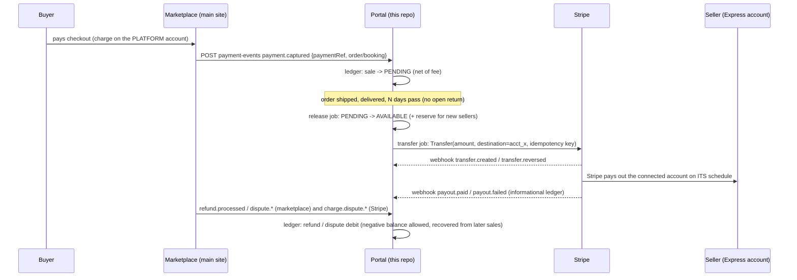

# Seller payments & payouts (workstream I)

Buyers pay at checkout on the main Solvelt website (a separate system). The portal is the **seller side**: it keeps the **ledger** of what each seller account is owed, decides **when funds become available**, moves them to the seller's **Stripe Express connected account** (Stripe *separate charges and transfers*), and mirrors Stripe's payouts. Everything is built and tested in Stripe **test mode**; no real money. Without a Stripe key the app runs a deterministic **fake provider** (Development/Testing); CI never calls Stripe.

Code: `src/Solvelt.Api/Payments/**`, entities `Domain/Payments.cs`, one EF migration `Payments`. Tests: `tests/Solvelt.Api.Tests/Payment*Tests.cs`. Frontend (Payments pages): see `docs/ROADMAP.md` / the frontend `docs/DESIGN.md` (blocked until the frontend repo is attached; the API below is complete).

## 1. Money flow



## 2. Ledger model

Append-only, **double entry**, integer **minor units** (`long`) with a **currency on every entry**. A *journal* groups balanced entries (sum = 0, checked on write and by the reconciliation job). Journals have a **unique idempotency key**: the same source event posted twice creates nothing new. Journals/entries are never updated or deleted (the `DbContext` throws on any attempt); a correction is a new journal.

Accounts: seller-owned **Pending, Available, Reserved, Settled** (sent to Stripe, awaiting payout), **PaidOut**; counter accounts **Platform** (buyer money the marketplace holds) and **Fees** (marketplace revenue). Positive on a seller account = the platform owes the seller.

| Journal type | Entries (sum 0) | Idempotency key |
|---|---|---|
| `sale` (order) | Platform −(items − discount + shipping); Pending +items, +shipping, −fee; Fees +fee | `sale:{sellerOrderId}` |
| `sale` (booking) | Platform −total; Pending +total, −fee; Fees +fee | `sale:{bookingId}` |
| `policy_fee` / `extra_charge` | same shape on the amount (cancellation / no-show fee, accepted extra charge), fee at the current platform rate | `{kind}:{eventId}` |
| `refund` | Platform +refund; Fees −fee returned; Pending −(up to what is still pending for that order), Available −rest | `refund:{refundId}` |
| `dispute`, `dispute_fee` | Platform +amount / +fee; Available −amount / −fee | `dispute:{id}:{sellerOrderId}`, `dispute-fee:{id}:{sellerOrderId}` (bookings: the booking id; rows booked before C10 keep `dispute:{id}`) |
| `dispute_won` | Platform −amount; Available +amount | `dispute-won:{id}:{sellerOrderId}` |
| `release` | Pending −x; Available +(x − reserve); Reserved +reserve | `release:{orderOrBookingId}:{lastPendingEntryId}` |
| `reserve_release` | Reserved −r; Available +r | `reserve-release:{entryId}` |
| `adjustment` (staff) | Available ±x; Platform ∓x | `adjustment:{requestId or random}` |
| `transfer` | Available −x; Settled +x | `transfer:{transferId}` (+ `transfer-retry:{id}:{n}`) |
| `transfer_failed` / `transfer_reversed` | Settled −x; Available +x | `transfer-failed:{id}:{n}`, `transfer-reversed:{id}` |
| `payout` / `payout_reversed` | Settled −x; PaidOut +x (and back) - informational | `payout-paid:{id}`, `payout-reversed:{id}` |

**Balances** per seller and currency: *pending* (not yet releasable), *available* (releasable), *reserved*, *in transit* (= Settled: sent to Stripe, not yet paid out), *paid out*. `owed = pending + available + reserved`.

**Rounding (documented, tested):** all money is integer cents. The marketplace fee is `round-half-up((items - discounts) x bps / 10000)` **per order line group** (done at order ingest, `OrderSupport.Fee`); booking and policy-fee fees use the same rule with the platform fee setting at posting time. A partial refund returns the fee `round-half-up(fee x refundedItems / soldItems)`; the **last** refund of the items takes the remainder, so the fee is never over- or under-refunded. Reserve = `round-half-up(released x percent / 100)`.

**Tax policy:** tax collected by the marketplace is remitted by the marketplace and is **not seller money**: it never enters the ledger (matches `docs/ORDERS.md`: `Net = items - discounts + shipping - fee`). Refund events carry item and shipping amounts only. Tax handling/VAT engines are out of scope.

**Negative balance policy:** *negative* means `pending + available + reserved < 0` (the seller owes the platform). A shipping label debits Available while the sale is still Pending: that is not a negative balance. a refund or dispute is always debited, even if the seller's available balance is too low (it goes negative). A negative balance is shown to the seller, the Owners get one email when it turns negative, **no transfer is created while available <= 0**, and the debt is recovered automatically from future releases (released funds first fill the hole; only what is left above `MinTransferCents` is transferred). Staff can see it and adjust.

## 3. Release rules

A scheduled job (`ReleaseService`, every `Payments:JobIntervalSeconds`, leased) moves funds Pending -> Available:

* **Orders:** order status Delivered, Completed or **Refunded** (a refund after a received return, or a goodwill refund, moves an order to Refunded even when only part of it was refunded; what is still pending for the kept items releases), `DeliveredAt + Payments:ReleaseDays` (default **7**; an order that never got a delivery mark anchors on its completion, else on its last return-received / refund time, so a shipped-returned-refunded or rejected-return order never keeps money pending forever) has passed **and** the return window has closed: `Payments:RequireReturnWindowClosed` defaults to **true**, so funds wait for `max(ReleaseDays, Orders:ReturnWindowDays)` (30) after delivery (set it to false to release after `ReleaseDays` only; the reserve and the negative-balance recovery cover late refunds). Open returns/cancellations keep the order out of Delivered/Completed (state machine in `docs/ORDERS.md`), so nothing is released while a return is open. Release is **per seller order** (the unit the portal sells and refunds in), not per order line.
* **Bookings:** Completed + `ReleaseDays` after `CompletedAt`; cancelled/no-show bookings holding a fee: `ReleaseDays` after the last update. Extra charges/fees captured after a release release on the next run.
* **Refunds before release** reduce Pending (what is left attached to that order); after release they debit Available.
* **Reserve:** accounts younger than `Payments:NewSellerDays` (90) keep `Payments:NewSellerReservePercent` (10 %) of every release in **Reserved**; each reserve entry is released to Available after `Payments:ReserveReleaseDays` (30).

## 4. Transfer job

`TransferService` (same leased job, after the release job):

1. For each seller + currency with `Available >= Payments:MinTransferCents` (500) it creates **one `PaymentTransfer` per seller + currency + UTC day** (unique `IdempotencyKey = seller:currency:yyyyMMdd`) and, **in the same transaction**, the `transfer` journal Available -> Settled. The loser of a race hits the unique key and does nothing; funds can never be sent or spent twice.
2. Due transfers are claimed with an atomic lease, sent to Stripe with the idempotency key, and marked `Created`. Transient errors back off (`TransferBackoffSeconds x 2^(attempt-1)`, max 1 h) up to `TransferMaxAttempts` (5); then the transfer is `Failed`, a compensating `transfer_failed` journal returns the funds to Available, the Owners get an email and staff see it in the failed list. Staff **retry** re-debits Available and queues it with a new Stripe idempotency key.
3. **Paused** (nothing is sent, funds stay in the ledger): seller Suspended/Closed/Rejected, **no connected account** or Stripe **payouts disabled**, an active **staff hold**.
4. `transfer.reversed` (Stripe) credits **only the reversed part**: Stripe also sends it for partial reversals (`reversed=false`, `amount_reversed < amount`), so the ledger credits `amount_reversed` minus what it already credited (running total, idempotent per total, never takes back), and closes the transfer only when it is fully reversed. Reconciliation compares `amount_reversed` with the ledger.
5. Staff **retry** runs under the same job lease as the batch (`409 busy` while the job runs) and in one serializable transaction: the status change and the Available -> Settled journal commit together or not at all.

The lease is renewed at every step of a run (a long reconciliation keeps it; an expired lease is never revived); reconciliation only re-checks transfers created within `Payments:ReconcileDays`. Several instances can run the job: the lease (`payment_job_leases`, atomic UPDATE) keeps them apart, the unique transfer key is the backstop (works on PostgreSQL and SQLite).

## 5. Onboarding (Stripe Express)

One connected account per **seller account**, created on demand by an **Owner**: `POST /api/v1/seller/payments/onboarding` creates the Express account (Stripe idempotency key `acct-{sellerId}`), returns a hosted **Account Link** (`url`, `expiresAt`; return/refresh URLs `{FrontendBaseUrl}/payments?onboarding=return|refresh`). Only Approved sellers can start. Status comes from `account.updated` webhooks (or `POST .../onboarding/sync`): `not_started | in_progress | action_required | restricted | active`, with `currentlyDue`, `pastDue`, `disabledReason`, `deadline`, plain-language `nextSteps`, and payout settings read from Stripe (`interval`, `delayDays`, `bankLast4`, `bankName`): **no card or bank numbers are stored**, only Stripe ids and last-4. `POST .../dashboard-link` returns a one-time **Express dashboard** login link (Owner, after onboarding). Disputes are answered there (in-portal evidence upload is out of scope).

## 6. Inbound contract (marketplace -> portal)

Same HMAC scheme as `docs/ORDERS.md` section 3.1 (timestamp, nonce, signature; secret `Orders:InboundSecret`). One endpoint:

`POST /api/internal/v1/payment-events` body `{ "eventId": "<unique per event, <=100 chars>", "type": "...", "data": { ... } }`

Responses: `200 {status:"ok"|"duplicate", result}` (`duplicate` only when this very `eventId` was already processed); `409 concurrent_update` when a concurrent change (a unique conflict that is not this event, or a PostgreSQL serialization failure) kept the event from being stored: **nothing was applied, re-send it**; `404 order_not_found | booking_not_found` and `409 sale_not_recorded` are **retryable** (the order/capture has not arrived yet); `422` with `code` for invalid input. Idempotent on `eventId` **and** on the source ids of the journals.

| `type` | `data` | Effect |
|---|---|---|
| `payment.captured` | `{kind: "order"\|"booking"\|"booking_cancellation_fee"\|"booking_no_show_fee"\|"booking_extra_charge", marketplaceOrderId, sellerOrderNumber?, marketplaceBookingId, paymentRef, currency, amountCents? (fees/extras), capturedAt?}` | Posts the sale (every seller order of the marketplace order unless `sellerOrderNumber`), stores `paymentRef` (Stripe charge or payment intent id). Fees/extras must not exceed the booking's `CancellationFeeCents` / `AdditionalChargeCents`. |
| `refund.processed` | `{refundId, marketplaceOrderId + sellerOrderNumber? \| marketplaceBookingId, amountCents (items), shippingCents?, currency?, reason?}` | Refund journal; the order must be unambiguous (`sellerOrderNumber` when the marketplace order has several seller orders); refunds above what was sold: `422 exceeds_sale`. |
| `dispute.created` / `dispute.updated` / `dispute.closed` | `{disputeId (the Stripe dp_ id), marketplaceOrderId (+sellerOrderNumber, **required** when the order has several seller orders) \| marketplaceBookingId, amountCents (this seller order's share), feeCents?, currency?, reason?, status: needs_response\|under_review\|won\|lost\|warning_closed, evidenceDueBy?}` | Debit of amount + dispute fee on first sight **per (disputeId, seller order)** (whichever event comes first), credit on `won`, status/evidence date updates; closed disputes are never reopened by older events. See *Disputes on multi-seller orders* below. |

```json
{ "eventId": "evt-9f2", "type": "payment.captured",
  "data": { "kind": "order", "marketplaceOrderId": "MP-10045", "paymentRef": "pi_3Nxyz", "currency": "USD" } }
```

## 7. Stripe webhooks

`POST /api/webhooks/stripe` (anonymous, authenticated **only** by the signature). Register it as a **platform** endpoint and a **Connect** endpoint (connected-account events) in Stripe with the same signing secret `Stripe:WebhookSecret`. `Stripe-Signature: t=<unix>,v1=<hex>` over `"{t}.{raw body}"` with HMAC-SHA256; several `v1` values (secret rotation) are accepted. Wrong/missing/malformed signature or a timestamp more than `Payments:WebhookToleranceSeconds` (300) away -> `400`; no secret configured -> `503`. Bodies over 1 MB -> `413`.

Processing is **idempotent on the event id** (the `processed_payment_events` row commits in the same transaction as the effects; a replay answers `200 duplicate`) and **order independent** (every mutable row remembers the Stripe event time of the last applied event; an older event is ignored, closed/reversed states are terminal). Unknown types, objects and accounts are acknowledged (`200`) and ignored.

| Event | Effect |
|---|---|
| `account.updated` | Syncs `details_submitted`, `charges_enabled`, `payouts_enabled`, `requirements.currently_due/past_due/disabled_reason/current_deadline`, bank last-4, payout schedule; emails the Owners once per distinct requirement set |
| `transfer.created/updated/paid/reversed` | Mirrors the transfer (matched by Stripe id or `metadata.transferId`); `reversed` returns the funds |
| `payout.created/updated/paid/failed/canceled` (connected account, `event.account`) | Upserts the payout; `paid` posts the informational `payout` journal; `failed/canceled` after paid reverses it and emails the Owners |
| `charge.dispute.created/updated/closed` | Inquiries (`warning_needs_response` -> status `inquiry`, `warning_under_review` -> `inquiry_review`; the latter is no longer respondable, `canRespond` is false), **move no money**, but DO need a response: the seller sees them with `canRespond` and the evidence due date, the Owners get one email, and they count as open disputes (nor does `warning_closed`); the amount + dispute fee are debited exactly once, when the dispute first reaches a state where money moves (`needs_response`, `under_review`, `won`, `lost`). Matched through the stored `paymentRef` (`charge` or `payment_intent` -> the marketplace order -> its seller orders); exactly one seller order/booking -> same effect as the marketplace events (same `dp_` id and seller order = same dispute row, same idempotency keys, so the two sources never debit twice); a charge that maps to **several** seller orders never debits (below); a charge that maps to nothing and a dispute id that is not known -> a staff **reconciliation flag** `dispute_unattributed` |

### Disputes on multi-seller orders (C10)

One Stripe charge covers the whole marketplace order, so one dispute (`dp_...`) can span several seller orders.

* **Key.** A dispute row is one **(disputeId, seller order)** (bookings: (disputeId, booking)); unique indexes on both. The ledger keys are `dispute:{dp}:{sellerOrderId}`, `dispute-fee:...` and `dispute-won:...`. Status, won/lost/closed and the never-reopen rule apply per row. Rows booked before this change keep their old keys (`dispute:{dp}`) so a replay does not post twice.
* **Marketplace events.** One `dispute.*` event per seller order, each with `sellerOrderNumber` and that seller order's share in `amountCents` (+ optional `feeCents`). `sellerOrderNumber` is **required** when the marketplace order has more than one seller order (`422 seller_order_required`; an event with only a `disputeId` for a dispute that already has several rows is the same error). The share must not exceed that seller order's sale (items - discount + shipping): `422 exceeds_sale`. Single-seller orders work without `sellerOrderNumber`.
* **Stripe `charge.dispute.*`.** Matching: `charge` / `payment_intent` -> stored payment reference -> marketplace order -> its seller orders. One seller order: as before. **Several seller orders (or several allocated rows): no seller is ever debited by this webhook.** It records status and evidence date on every row the marketplace already allocated, and keeps an **unallocated dispute** item (`payment_unallocated_disputes`, plus a `dispute_unallocated` reconciliation flag in the list staff already use) open while the allocated shares are below the Stripe amount. No ledger entries. The item keeps the latest Stripe status, so a row the marketplace allocates later starts from the newer Stripe state. Debits and the won credit come only from the marketplace events; when the shares add up to the Stripe amount the item and its flag are cleared automatically. If the shares can never add up (for example Stripe's amount includes tax), staff resolve the flag with a reason: that closes the item for good and later Stripe updates do not reopen it.
* **No double debit.** Both sources use the same row and the same idempotency keys per (dispute, seller order), whichever arrives first.

Example, marketplace order `MP-1` split between seller orders `A-1001` (sale 2400) and `B-2002` (sale 3500), one Stripe dispute `dp_9` of 5900:

```json
{ "eventId": "e1", "type": "dispute.created", "data": { "disputeId": "dp_9", "marketplaceOrderId": "MP-1", "sellerOrderNumber": "A-1001", "amountCents": 2400, "feeCents": 1500 } }
{ "eventId": "e2", "type": "dispute.created", "data": { "disputeId": "dp_9", "marketplaceOrderId": "MP-1", "sellerOrderNumber": "B-2002", "amountCents": 3500, "feeCents": 1500 } }
{ "eventId": "e3", "type": "dispute.closed",  "data": { "disputeId": "dp_9", "marketplaceOrderId": "MP-1", "sellerOrderNumber": "A-1001", "status": "won" } }
```

## 8. Permissions

Extends the matrix in `docs/TEAMS.md`. Roles are re-read from the database on every request; another account's data is **404**, never 403.

| Seller permission | Owner | Admin | Manager | Viewer |
|---|:-:|:-:|:-:|:-:|
| `PaymentsRead`: balances, ledger, transfers, payouts, statements (+CSV), disputes, onboarding status | ✔ | ✔ | – | – |
| `PaymentsManage`: start/continue onboarding, sync, Express dashboard link | ✔ | – | – | – |

Seller API (`/api/v1/seller/payments`, rate limit `RateLimit:PaymentsPerMinute` 120/user): `summary` (balances per currency, `nextTransferAt`, `payoutsPaused` with a generic reason - the staff reason is never shown, `minTransferCents`, open disputes, onboarding), `ledger` (`type, from, to, orderId, bookingId, reference (part of an order/booking number, over all rows), page, pageSize`; rows carry `orderNumber`/`bookingNumber` for drill-down) + `ledger/{id}`, `transfers`, `payouts`, `disputes` (evidence due dates, `canRespond`), `statements` (months), `statements/{yyyy-MM}` (opening, sales, fees, refunds, disputes, adjustments, transfers, closing, paid out), `statements/{yyyy-MM}/csv` (formula-safe: cells starting with `= + - @` TAB CR get a leading apostrophe; the amount column is a plain decimal), `onboarding` (GET/POST), `onboarding/sync`, `dashboard-link`.

Payment emails (payout failed, transfer failed, dispute opened, negative balance, staff adjustment, onboarding needs action) go to **Owners always** and to **Admins who opted in** (`PUT /seller/notification-preferences {paymentEmails:true}`, Admin only); each is sent once per event.

| Staff permission (`docs/ADMIN.md`) | Super admin | Support | Moderator | Read-only | Step-up |
|---|:-:|:-:|:-:|:-:|:-:|
| `PaymentsView`: seller balances/ledger/Stripe status, failed transfers/payouts, past-due accounts, reconciliation flags | ✔ | ✔ | ✔ | ✔ | |
| `PaymentsHold`: place / release a payout hold (reason, audit) | ✔ | ✔ | | | |
| `PaymentsRetry`: retry a failed transfer, run/resolve reconciliation | ✔ | ✔ | | | |
| `PaymentsAdjust`: manual credit/debit (reason, audit, seller notified) | ✔ | | | | ✔ |

Staff API under `/api/v1/admin/payments`: `sellers/{id}` (balances, Stripe account + onboarding status, holds, failed transfers, open disputes), `sellers/{id}/ledger`, `sellers/{id}/hold` + `hold/release`, `sellers/{id}/adjustments` (`{direction: credit|debit, amountCents, currency, reason, requestId?}`), `transfers?status=`, `transfers/{id}/retry`, `payouts?status=`, `accounts/requirements-past-due`, `reconciliation` + `reconciliation/run` + `reconciliation/{id}/resolve`, `unallocated-disputes?open=` (Stripe disputes on multi-seller charges that the marketplace has not fully allocated).

## 9. Reconciliation

`ReconciliationService` (in the leased job, and `POST admin/payments/reconciliation/run`) compares every `Created`/`Reversed` ledger transfer with Stripe (`RetrieveTransfer`; the fake provider in tests): missing at Stripe, different amount/currency/destination, reversed at Stripe but not in the ledger -> a `transfer_mismatch` flag; it also flags any journal that does not sum to zero. An open flag is never duplicated; staff resolve flags with a reason (audited).

## 10. Configuration

`Payments`: `ReleaseDays` 7, `RequireReturnWindowClosed` true, `NewSellerReservePercent` 10, `NewSellerDays` 90, `ReserveReleaseDays` 30, `MinTransferCents` 500, `TransferMaxAttempts` 5, `TransferBackoffSeconds` 60, `DefaultDisputeFeeCents` 1500, `WebhookToleranceSeconds` 300, `RunBackgroundJobs` true, `JobIntervalSeconds` 300, `LeaseSeconds` 300, `WebhooksPerMinute` 1200, `ReconcileDays` 35, `AllowTestKeysInProduction`, `AllowLiveKeysOutsideProduction`. `Stripe`: `SecretKey` (`STRIPE_SECRET_KEY`), `WebhookSecret` (`STRIPE_WEBHOOK_SECRET`), `DefaultCountry` US. **Keys only from configuration/environment, never committed.**

* No key: Development/Testing use the **fake provider**; any other environment uses an *unconfigured* provider (payments endpoints answer `503 payments_not_configured`, nothing is faked, the app still starts).
* **Production refuses to start with a test key** (`sk_test_`/`rk_test_`) unless `Payments:AllowTestKeysInProduction=true`; a **live key outside Production** is refused unless `AllowLiveKeysOutsideProduction=true`; anything that is not an `sk_`/`rk_` key is refused.
* Logs never contain amounts per person, bank details or Stripe secrets; webhook bodies are not logged; staff views show Stripe ids only.
* Dev/Testing helpers (never mapped elsewhere): `POST /api/dev/payments/run` (release + transfers + reconcile), `complete-onboarding/{sellerId}`, `capture/{orderId}`, `refund/{orderId}`, `age-order/{orderId}` (moves the delivery past the release delay and the return window; drive the flow from E2E tests).

## 11. Opt-in Stripe test-mode tests

`tests/Solvelt.Api.StripeTests` (separate project, trait `Category=StripeTestMode`, **not** part of CI): with `STRIPE_SECRET_KEY=sk_test_...` set it creates a real Express test account, an account link and a login-link attempt, and a transfer rejected for lack of funds/capabilities; without the key the tests return immediately (they are plain facts that exit early, never reported as skipped unit tests). `dotnet test tests/Solvelt.Api.StripeTests`.

## 12. Going-live checklist

1. **Stripe account:** activate the platform account (business verification, bank account). Enable **Connect**, choose **Express** accounts, platform profile and branding (name, icon, colours, support email, terms/privacy links shown in onboarding).
2. **Connect settings:** *separate charges and transfers*; capabilities `transfers` (card payments are not requested for connected accounts); set the default **payout schedule** for connected accounts (daily with 2-day delay is the Stripe default; weekly/monthly if you prefer) and decide whether sellers may change it (Express dashboard).
3. **Tax settings:** Express accounts collect tax identity during onboarding; Stripe produces 1099-K/1099-NEC style forms where applicable. Confirm the tax reporting settings under Connect -> Settings -> Tax reporting. Marketplace VAT/GST is out of scope.
4. **Live keys:** set `STRIPE_SECRET_KEY` (`sk_live_`/restricted key with Connect + Transfers write, Accounts write) and `STRIPE_WEBHOOK_SECRET` in the production secret store; set `ASPNETCORE_ENVIRONMENT=Production`; leave `AllowTestKeysInProduction` false.
5. **Webhook endpoints:** one **platform** endpoint and one **Connect** endpoint (`Listen to events on Connected accounts`), both `https://<host>/api/webhooks/stripe`, events: `account.updated`, `transfer.created`, `transfer.updated`, `transfer.reversed`, `payout.created`, `payout.updated`, `payout.paid`, `payout.failed`, `payout.canceled`, `charge.dispute.created`, `charge.dispute.updated`, `charge.dispute.closed`. If both endpoints use different signing secrets, run the platform and Connect endpoints with the same secret rotation window (the verifier accepts several `v1` signatures but one configured secret).
6. **Marketplace side:** the main website must send `payment.captured` for every successful charge/booking payment (with the Stripe charge or payment-intent id), `refund.processed` for every refund, and either `dispute.*` or let Stripe's `charge.dispute.*` reach this webhook (same `dp_` id = one dispute). Create charges with a `transfer_group` per order if you want Stripe-side grouping.
7. **Run:** migrate the database (`dotnet ef database update`), keep `Payments:RunBackgroundJobs=true` on at least one instance, check *Integration health -> jobs* (`payments-release`, `payments-transfers`, `payments-reconcile`), then run a small live transfer with a staff account before opening payouts to all sellers.
8. **Monitor:** staff lists of failed transfers/payouts, accounts with requirements past due, open reconciliation flags; alert on the job's `LastSucceeded=false`.

## 13. Test coverage and mutation checks

`tests/Solvelt.Api.Tests/Payment*Tests.cs` (xUnit, fake Stripe provider, signed fake webhooks, fake clock): onboarding, status sync and out-of-order account events; ledger entries for every source event (sale, booking sale/fee/extra, refund, dispute, adjustment, release, reserve, transfer, payout); idempotency (duplicate events/webhooks, concurrent postings); release rules (delivery + N days, open returns, optional return window, reserve and its release, negative balances and recovery); transfer batching, minimum amount, pauses (suspended / no account / payouts disabled / staff hold), retries with backoff, permanent failures + staff retry, parallel runs -> exactly one transfer and one Stripe call; webhook signatures (valid, invalid, malformed, stale, replayed, no secret), out-of-order transfer/payout/dispute events; seller and staff permission matrices, IDOR, formula-safe CSV, key guards.

Each of these checks was reverted by hand once to prove a test fails without it (mutations applied one at a time, then undone): journal idempotency (check **and** unique index), webhook signature verification, webhook replay protection, fee remainder on the last refund, compensating journal of a failed transfer, dispute posted whichever event arrives first, reserve withholding and release timing, minimum transfer amount, the four transfer pauses, refund-before-release reducing Pending, negative-balance email, transfer reversal returning funds, Owner-only onboarding/dashboard, the shared cancellation/no-show fee cap, step-up on adjustments, release delay, stale account event guard, batch idempotency key, formula-safe CSV, append-only guard, IDOR on the ledger detail, Admin lacking `PaymentsManage`.

## 14. Concurrency notes

* Refund/dispute events and the release job read a balance and write against it, so both run in **serializable** transactions and the release re-reads the order's pending sum inside its transaction: a refund that commits at the same moment is part of the released amount and Pending can not go negative. On SQLite (tests) writers are serialised by the database; on **PostgreSQL** a conflicting pair makes one transaction fail with a serialization error, which is answered `409 concurrent_update` (events: the sender retries) or skipped (release: the next run re-reads). All four money paths (refund/dispute ingest, release, staff retry) open their transaction through one helper that always uses Serializable, and a test asserts it; PostgreSQL serialization failures (`40001`/`40P01`, also raised at COMMIT) are caught and answered `409 concurrent_update` (events, retry) or skipped (release), and the transaction is rolled back before the duplicate check (a failed statement aborts a PostgreSQL transaction, `25P02`). The actual PostgreSQL behaviour is **not exercised by an automated test** (the suite runs on SQLite); retry reads the available balance inside its transaction.
* Stripe webhooks answer `409 concurrent_update` (Stripe retries) instead of acknowledging an event that lost an insert race.
* **Lease owner token (round 4):** each run holds a random owner token; renew/release are owner-conditional and a run that loses its lease aborts. The lease is re-checked at every loop iteration (migration `PaymentsLeaseOwner`). **Clock skew:** the lease comparisons use the instance clock, not the database's `now()`: keep instance clocks within a few seconds of each other (NTP required), far below `LeaseSeconds` (300).
* A 40001/40P01 from a handler or from COMMIT is a `409 concurrent_update`; no rollback is attempted once COMMIT has failed. The release job skips the order and carries on.
* `DeliveredAt` is never before any shipment's shipped/delivered time. Stripe `warning_under_review` is the `inquiry_review` dispute status (no money moves, still counted as open). Reconciliation covers transfers created or updated in the window. The admin ledger endpoint supports `reference`.
