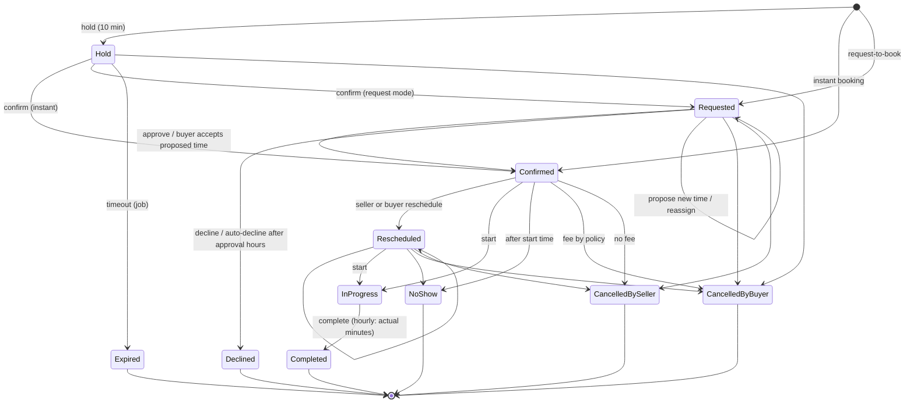

# Services, calendars and bookings (workstream F)

Services live in the **same catalog as products** (`products.Type = Service`). Each team member who provides services has **their own calendar**; every
booking is assigned to one provider. Buyers book on the main Solvelt site (a separate system) through the **signed internal API**; every seller-side change
goes back through the **outbox** of `docs/ORDERS.md`. Money (charging, fees, refunds, extra time) is the marketplace's job: the portal only records the
seller's decisions and amounts.

Code: `src/Solvelt.Api/Bookings/**`, entities `Domain/Bookings.cs`, one EF migration `Services`. Tests: `SlotEngineTests`, `ServiceListingTests`,
`BookingFlowTests`, `QuoteFlowTests`, `BookingExtrasTests` (+ `ServiceTestKit.cs`).

> Frontend (Calendar, Bookings, Availability settings, service editor sections) is **not built yet**: attaching `Yanky1/test-login-frontend` to the
> session was refused by the permission check. Everything below is exposed through the API and the simulator so the UI can be built against it.

## 1. Data model
| Entity | Purpose |
|---|---|
| `Product.Type` (`Product` \| `Service`) | One column on the existing listing. Services share brand, title, photos, description, bullets, category, FAQ, SEO, publish rules and the readiness checklist. Stock/shipping/variants are ignored for services. |
| `ServiceDetails` (1:1, key `ProductId`) | Price model (`Hourly` rate/h, `Fixed` per job, `Quote`), min/max minutes, billing increment 15/30/60, default duration, buffers before/after, minimum notice (h), maximum advance (days), slot granularity, locations (`Online` + instructions, `AtCustomer` + service area + travel fee + travel buffer, `AtSeller` + address), booking mode (`Instant`/`Request` + approval hours), intake questions, requirements, add-ons, cancellation/reschedule/no-show policy, assignment rule, denormalised `ReadyProviders`. |
| `ServiceProviderLink` | Which members may perform a service. |
| `ProviderProfile` (key `MembershipId`) | `IsProvider`, time zone (default: account zone), reminder preferences, hashed ICS token, `CalendarSeq` (the per-provider lock, see 3). |
| `BookingSettings` | Account time zone + hashed account ICS token. |
| `WorkingHour` / `DateOverride` / `CalendarBlock` | Weekly intervals (minutes after local midnight), date-specific replacement hours (empty = closed), time off and manual "busy" blocks (UTC, optional all-day). |
| `Booking` | `BK-yyyy-nnnnnn`, marketplace id (unique), status, UTC start/end plus the **block** (service time + buffers + travel) used for overlap checks, customer data (PII), price snapshot in cents, **policy snapshot** (`PolicyJson`), version. |
| `BookingEvent`, `BookingMessage`, `BookingCounter` | Timeline, per-booking thread, number counter. |
| `QuoteRequest` | Request details, address/area, preferred times, the seller's quote (price, duration, slots, provider, expiry, note), status. |

Money is `long` cents. Add-ons: `{id, name, priceCents, extraMinutes}`. The service area is `{postalCodes:[...], radius:{baseAddress, lat, lng, distance, unit}}`;
postal codes match exactly or by prefix (`112*`), the radius is a haversine distance from the base point (km or mi).

## 2. Slot engine (single source of truth)
`Bookings/SlotEngine.cs` is a pure function over a `ProviderCalendar` (zone, weekly hours, overrides, time off, busy footprints). Rules:

1. **Working hours** are local wall-clock intervals of the provider's zone, converted **per local date** to UTC, so the UTC instants follow DST: 9-17 is 14:00-22:00Z in winter and 13:00-21:00Z in summer (New York); a day's real length is 7 h / 9 h on the spring-forward / fall-back Sunday when the interval spans the change. A local time that does not exist (spring-forward gap) is shifted forward by the size of the gap (02:30 becomes 03:30); an ambiguous local time (fall-back) is read as standard time.
2. A **date override** replaces the weekly hours of that local date; an empty override closes the day and an override can open a normally closed day.
3. The **service time** `[start, start + duration)` must lie inside ONE working interval and must not touch **time off / blocks**.
4. The **footprint** `[start - bufferBefore - travel, end + bufferAfter + travel)` must not overlap the footprint of any booking (`Requested`, `Confirmed`, `Rescheduled`, `InProgress`) or **live hold**. Buffers may reach outside working hours. `travel` (the service's travel buffer) applies only to at-customer jobs; because an existing job's footprint already carries its own travel, back-to-back at-home jobs need `2 x travel` between them in the worst case.
5. **Minimum notice** (`start >= now + notice`) and **maximum window** (`start <= now + maxAdvanceDays`).
6. **Granularity**: starts are generated from each working interval's start in steps of the slot granularity; a booking must start on that grid (checked server-side on create, so a client cannot book 10:07).
7. Hourly services: the buyer chooses the duration (min, max, multiple of the increment); add-ons add their extra minutes.

Availability for "any provider" merges the providers' slots (`providerIds` per slot). Expired holds never block, even before the job marks them `Expired`.

## 3. No double booking
Every booking write runs in a transaction that **first bumps `provider_profiles.CalendarSeq` with an atomic `UPDATE`** (a per-provider lock: on PostgreSQL the row lock is held until commit, on SQLite writers serialise), then **re-reads the provider's calendar** and re-checks the slot with the same engine, and only then inserts/moves the booking. Two simultaneous requests for one slot: exactly one `201`, the rest `409 slot_unavailable` (test: 8 parallel requests). Idempotency: the marketplace booking id has a unique index; a race on it returns the winner's booking (`200`, `created:false`).
Reschedule, propose-accept, reassign and re-confirm of an expired hold use the same lock.

## 4. Booking state machine

`BookingStateMachine` is the only place that knows the legal transitions; everything else answers `409 invalid_state` and writes nothing (not even an outbox row). `Rescheduled` behaves like `Confirmed`. A hold is not shown in seller lists.

Rules on top of the diagram:
* **Request-to-book**: `approvalDeadline = createdAt + approvalHours`; approving after the deadline is `409 request_expired`; the job auto-declines (`booking.declined` with `auto:true`, `reason:"no_response"`). A pending request blocks its slot.
* **Propose a new time** (Requested only): stored as `proposedStartAt`, the slot is *not* reserved; the buyer answers through `proposal-responses`. Accepting re-checks the slot (`409` if gone) and confirms at the new time; declining cancels the request.
* **Seller reschedule** moves the booking at once to a free slot and emits `booking.rescheduled` with `requiresBuyerConsent:true` (the marketplace asks the buyer; the buyer can cancel without a fee). It does not count against the buyer's reschedule limit.
* **Buyer reschedule request**: instant-booking services apply it immediately if the slot is free; request-mode services keep it pending (`rescheduleRequestedStartAt`) for approve/decline. Refused with `409 reschedule_limit` after `maxReschedules`, and `409 too_late` inside the free window (`cancelFreeHours`). Idempotent on `requestId`.
* **Cancellation fee**: only when a **buyer** cancels a *confirmed/rescheduled* booking less than `cancelFreeHours` before the start: `round-half-up(total x cancelFeePercent / 100)`. Pending requests, holds and every seller cancellation are free. The fee is recorded on the booking and sent in `booking.cancelled` (`cancellationFeeCents`, `refundDueCents`). Policy values are **snapshotted at booking time**, later edits of the service never change an existing booking.
* **No-show**: only once the start time has passed (`409 too_early`); fee = `noShowFeePercent` of the total.
* **Complete** (hourly): the time actually worked is required. Billed minutes = actual rounded **up** to the billing increment; if `billed >` the **full booked duration (add-on minutes included, they are already priced as add-ons)** an **additional charge request** is recorded and sent (`booking.additional_charge_requested`, `amountCents = round(rate x extraMinutes / 60)`); the booked price is never changed. Less time or fixed/quote jobs: no extra event.
* **Reschedule requests** are cleared by start, complete and no-show; approve/decline of a pending request is only possible on a Confirmed/Rescheduled booking (`409` otherwise).
* **Reassign**: the new provider must be eligible for the service and free (`422 provider_not_eligible`, `409 provider_busy`).
* Every action takes an optional `version` (optimistic concurrency, `409 version_conflict`); the same token is checked by the database on save.

## 5. Quotes ("quote required" services)
1. Marketplace `POST /quote-requests` (details, address/area, preferred times, buyer) -> `Requested`, listed in the seller's inbox (`GET /seller/quote-requests`, badge count in `GET /seller/bookings/counts`).
2. Seller `POST /seller/quote-requests/{id}/quote` `{price, durationMinutes, slots[1..10], providerId, expiresAt (<= 60 days), note}`; every slot must be bookable for that provider right now. Status `Quoted`, outbox `quote.sent`. A quote may be re-sent while open. Seller `decline` -> `quote.declined`.
3. Buyer `POST /quotes/{id}/accept {marketplaceBookingId, start}` with one of the proposed slots -> a **Confirmed booking** (price = quote + travel fee, duration = quote) is created under the same slot lock; the quote moves `Quoted -> Accepted` **inside the booking transaction** (conditional update, unique `bookings.QuoteId`), so parallel accepts create exactly one booking (idempotent on the booking id). `409 quote_expired`, `409 quote_not_open`, `422 slot_not_offered`, `409 slot_unavailable` (the quote stays open). Buyer `decline` -> `Withdrawn`. The job expires old quotes (`quote.expired`).
Quote services cannot be booked directly (`422 quote_required`).

## 6. Marketplace contract additions
Same HMAC scheme, replay protection and body cap as `docs/ORDERS.md` section 3.1 (headers `X-Solvelt-Timestamp/Nonce/Signature`, canonical string of 5 lines, `Orders:InboundSecret`). GET requests are signed with an empty body. Rate limits: availability: `RateLimit:AvailabilityPerMinute` (600 per **service**, spent by *signature-verified* requests only; the marketplace is one caller for all shoppers, so a per-IP key would throttle them together) and `RateLimit:AvailabilityFailedPerMinute` (60 per client address for unsigned/forged requests, which therefore can never drain a service's bucket), other writes `RateLimit:InternalPerMinute`.

| Endpoint | Body / query | Result |
|---|---|---|
| `GET /services/{id}/availability` | `from`, `to` (<= 62 days), `providerId?`, `location` (`online\|customer\|seller`), `postalCode`, `lat`, `lng`, `minutes?`, `addOns=a,b` | `{durationMinutes, priceCents, providers:[{providerId,timeZone}], slots:[{startAt,endAt,providerIds}]}` |
| `POST /bookings/holds` | booking body (below) | `201` `{created, booking}` status `Hold`, `holdExpiresAt` (10 min) |
| `POST /bookings/{mid}/confirm` | buyer, address, intake answers | `Confirmed` (instant) or `Requested`; an expired hold is re-checked and may answer `409` |
| `POST /bookings` | booking body | create in one step (or convert the hold with that id); idempotent on `marketplaceBookingId` |
| `GET /bookings/{mid}` | - | summary (meeting link only for confirmed online bookings) |
| `POST /bookings/{mid}/reschedule-requests` | `{requestId, newStart}` | applied or pending (see 4) |
| `POST /bookings/{mid}/cancellations` | `{requestId?, reason}` | cancels, fee by policy; idempotent |
| `POST /bookings/{mid}/proposal-responses` | `{accept}` | answers a proposed time |
| `POST /bookings/{mid}/messages` | `{messageId, text}` | buyer message on the booking thread; idempotent on `messageId` |
| `POST /quote-requests`, `/quotes/{qid}/accept`, `/quotes/{qid}/decline` | see 5 | |

Booking body:
```json
{ "marketplaceBookingId": "BK-77", "serviceId": "<guid>", "providerId": "<guid or null>", "start": "2026-12-09T15:00:00Z", "durationMinutes": 120,
  "location": "customer", "addOnIds": ["deep"],
  "buyer": { "displayName": "Jane B.", "relayEmail": "relay-8f3a@relay.solvelt.example", "phone": "+1 555 000 1111" },
  "address": { "name": "Jane Buyer", "line1": "1 Main St", "city": "Brooklyn", "region": "NY", "postalCode": "11201", "country": "US", "lat": 40.69, "lng": -73.99 },
  "intakeAnswers": [ { "id": "pets", "answer": "no" } ] }
```
Errors: `404 service_not_found`, `409 slot_unavailable | no_provider`, `422 outside_service_area | location_not_offered | duration | add_on | intake_required | intake_invalid | provider_required | quote_required | marketplace_id`.
Without `providerId` the **assignment rule** chooses (`leastBusy`: fewest bookings in the next 30 days; `roundRobin`: rotates by provider id; `buyerChoice` with several eligible providers answers `422 provider_required`).

Example (any language, see `scripts/post-signed.sh`): availability
```
GET /api/internal/v1/services/5c1e.../availability?from=2026-12-09T00%3A00%3A00Z&to=2026-12-10T00%3A00%3A00Z&location=customer&postalCode=11201 HTTP/1.1
X-Solvelt-Timestamp: 1767225600
X-Solvelt-Nonce: 2f0d9c1a7b3e4c5d8a6b7c8d9e0f1a2b
X-Solvelt-Signature: v1=<hmac of "1767225600\n2f0d...\nGET\n/api/internal/v1/services/5c1e.../availability?from=...&postalCode=11201\n<sha256 of empty body>">
```

### Outbound events (portal -> marketplace, via the outbox)
`data.booking` is always `{bookingId, number, marketplaceBookingId}`; most events also carry `status, serviceId, providerId, location, startAt, endAt, totalCents`.

| Event | Extra `data` |
|---|---|
| `booking.requested` | `approvalDeadline` |
| `booking.confirmed` | `onlineInstructions` (online bookings only: the meeting link is revealed to the **confirmed** buyer), `auto` |
| `booking.declined` | `reason`, `auto` |
| `booking.time_proposed` | `proposedStartAt` |
| `booking.rescheduled` | `previousStartAt`, `initiatedBy` (`seller\|buyer`), `requiresBuyerConsent` |
| `booking.reschedule_requested` / `booking.reschedule_decided` | `requestedStartAt`, `requestId` / `decision`, `note` |
| `booking.cancelled` | `cancelledBy`, `reason`, `cancellationFeeCents`, `refundDueCents` |
| `booking.started`, `booking.completed` | `startedAt` / `completedAt`, `actualMinutes`, `billedMinutes` |
| `booking.additional_charge_requested` | `actualMinutes`, `billedMinutes`, `extraMinutes`, `rateCents`, `amountCents`, `currency` (**a request**, the price is unchanged) |
| `booking.no_show` | `noShowFeeCents`, `refundDueCents` |
| `booking.provider_changed` | `previousProviderId` |
| `booking.hold_expired` | - |
| `booking.reminder` | `kind` (`day_before\|hour_before`), `startAt` (the buyer reminder is the marketplace's job) |
| `quote.sent` | `quote:{quoteId, marketplaceQuoteId}`, `priceCents`, `durationMinutes`, `slots`, `providerId`, `expiresAt`, `note` |
| `quote.declined`, `quote.expired` | `reason`, `by` |
| `message.sent` | `kind:"booking"`, `messageId`, `text`, `sentAt` |

All events are written in the **same transaction** as the state change (a rejected action writes nothing) and use the existing signing, leases, retries and dead-letter handling.

## 7. Seller API (`/api/v1/seller/...`)
| Area | Endpoints |
|---|---|
| Catalog | `POST products {type:"service"}`, `GET products?type=service\|product`, `PUT services/{id}/details`, `GET\|PUT services/{id}/providers` (list items carry `type`, `priceModel`, `durationMinutes`) |
| Providers | `GET providers`, `PUT providers/{membershipId}` (`isProvider` Owner/Admin only; time zone and reminders: self or Owner/Admin), `PUT booking-settings` (account time zone) |
| Availability | `GET\|PUT providers/{id}/availability` (`weekly:[{day,intervals:[{start,end}]}]`, `overrides:[{date,intervals}]`; "HH:mm", no overlaps, <= 8 intervals/day), `GET\|POST providers/{id}/blocks`, `DELETE providers/{id}/blocks/{blockId}` (`kind: timeoff\|busy`, all-day by local date) |
| Calendar | `GET calendar?from&to&providerId&brandId&serviceId` -> providers (+ time zone), bookings, blocks, working-hour spans, `combined` |
| Bookings | `GET bookings?tab=requests\|upcoming\|today\|past\|cancelled&providerId&brandId&serviceId&q`, `bookings/counts` (badge), `bookings/{id}` (timeline, customer per privacy rules, pricing, policy, intake, `actions`), `POST bookings/{id}/approve\|decline\|propose\|reschedule\|approve-reschedule\|decline-reschedule\|cancel\|start\|complete\|no-show\|reassign`, `GET\|POST bookings/{id}/messages` |
| Quotes | `GET quote-requests`, `GET quote-requests/{id}`, `POST quote-requests/{id}/quote\|decline` |
| ICS | `POST\|DELETE providers/{id}/ics`, `POST\|GET\|DELETE calendar/ics` (account feed, Owner/Admin); public `GET /api/calendar/feeds/{token}.ics` |

## 8. Permissions (extends `docs/TEAMS.md`)
| | Owner | Admin | Manager | Viewer |
|---|---|---|---|---|
| Service listings (create/edit/providers) | all brands | all brands | their brands | read only |
| Mark members as providers (`Permission.ProvidersManage`), edit anyone's hours/time off, account feed | yes | yes | no (403) | no |
| Own working hours, time off, blocks, time zone, ICS feed | if provider | if provider | if provider | if provider |
| See bookings / calendar | all | all | their brands + bookings assigned to them | assigned to them if they are a provider, otherwise their brands |
| Act on a booking (approve, reschedule, cancel, ...) | all | all | their brands + assigned | **only bookings assigned to them** (provider) |
| Send / decline quotes | yes | yes | their brands | no (403) |
| Customer address, phone, intake answers | yes | yes | only if assigned provider (a pending request's intake answers: anyone who may act on it) | only if assigned provider |

Everything is resolved from the database on every request; other accounts' and out-of-scope records are **404**, never 403 (a visible-but-not-actionable booking is 403). The calendar view combines providers for Owner/Admin and shows only the caller's own provider calendar otherwise (Managers also see their brands' bookings). Writes are rate limited (`RateLimit:BookingsPerMinute`, 300 per user). Audit log: approvals, declines, proposals, reschedules, cancellations (incl. the policy fee in the event data), completions, no-shows, reassignments, provider changes, hours changes, quote sent/declined, ICS feed create/revoke. Entries never contain buyer data.

## 9. Privacy and retention
* Name, phone and address are visible only to the **assigned provider and Owners/Admins**, and only from **confirmation** (`Booking.ConfirmedAt`; a request or hold that was cancelled before it was ever confirmed never shows them) until redaction (a pending request shows the buyer's display name and the postal code only). The relay e-mail is never shown.
* `Bookings:RedactAfterDays` (default **30**) after a booking ended (completed, cancelled, declined, expired, no-show) the job wipes name, phone, e-mail, address, postal code and intake answers, replaces message texts, clears cancel/decline reasons and the texts of the timeline, replaces the payload of already **delivered** outbox events of that booking/quote (pending ones stay intact for the marketplace) and adds a timeline event; money and the policy snapshot stay. Closed quote requests are redacted the same way.
* The online meeting link is stored on the service, sent only in `booking.confirmed` (confirmed bookings) and shown to the team; hold and request responses never contain it.
* Reminder mails to providers contain the service, number and time only. Request logging does not log bodies; audit details carry ids only.

## 10. ICS feeds
A private, **read-only**, revocable subscription per provider and per account. Token: `ics_` + 43 base64url characters (256 bit), shown **once**, stored as SHA-256; regenerating revokes the previous link, `DELETE` revokes. The feed contains for each `Requested` (TENTATIVE), `Confirmed`, `Rescheduled`, `InProgress` booking: UID, times (UTC), SEQUENCE, a summary of service title and booking number and the *kind* of location. **No buyer name, address, phone or e-mail** (`Bookings:IcsIncludeBuyerName` opts the name in). Responses are `text/calendar`, `Cache-Control: private, no-store`, `X-Robots-Tag: noindex`; unknown tokens are 404; rate limited per IP. Two-way sync and importing external calendars are out of scope (ROADMAP).

## 11. Jobs and reminders
`BookingMaintenance` (hosted worker every 30 s outside Testing; `POST /api/dev/bookings/maintenance/run` in Dev/Testing): expire holds, auto-decline requests past `approvalDeadline`, expire quotes, send reminders (day before = within 24 h, and 1 h before; e-mail to the provider per `reminderDayBefore` / `reminderHourBefore`, plus a `booking.reminder` event for the buyer side; sent once each), redact. 

## 12. Simulator (Development / Testing only, never mapped elsewhere)
`GET seller/dev/services/{id}/slots`, `POST seller/dev/bookings {serviceId, start, providerId, location, minutes, mode: hold|confirm|book, addOnIds, intakeAnswers}`, `POST seller/dev/bookings/{marketplaceBookingId}/events {type: cancel|reschedule|accept_proposal|decline_proposal|confirm_hold}`, `POST seller/dev/quotes`, `POST seller/dev/quotes/{marketplaceQuoteId}/accept|decline`. They call the same services as the signed API, scoped to the caller's own services. `scripts/post-signed.sh` can sign real requests.

## 13. Configuration (`Bookings` section)
`HoldMinutes` 10, `RedactAfterDays` 30, `DefaultTimeZone` `UTC` (account zone when none was set; `PUT booking-settings` changes it), `MaxAvailabilityDays` 62, `IcsIncludeBuyerName` false, `RunBackgroundJobs` true; `RateLimit:BookingsPerMinute` 300, `RateLimit:AvailabilityPerMinute` 600 (per service, verified requests), `RateLimit:AvailabilityFailedPerMinute` 60 (per IP, failed requests).

## 14. Deploying the review-fix migration (`ServicesReviewFixes`)
* It adds `bookings.ConfirmedAt` and backfills it: confirmed/started/completed/no-show rows get `CreatedAt`; cancelled/declined/expired rows get the time of their `booking.confirmed` / `booking.approved` / `booking.proposal_accepted` timeline event (never-confirmed ones stay null, so their customer data stays hidden).
* It adds a **unique index on `bookings.QuoteId`**, which fails if a quote was accepted more than once before the fix. Check first and cancel/merge the extra bookings: `SELECT "QuoteId" FROM bookings WHERE "QuoteId" IS NOT NULL GROUP BY 1 HAVING count(*) > 1;`

## 15. Known limits
Hold/confirm/reschedule locking relies on the per-provider row lock: PostgreSQL in production (SQLite serialises writers, dev/test only). Round-robin and least-busy are evaluated per request (no fairness guarantee under heavy concurrency). Slot search covers at most 62 days per call. Removing or leaving a member who still has upcoming bookings is `409 has_upcoming_bookings` (extension point `IMemberRemovalGuard`, called by `TeamService`); a suspended member's ICS feed stops working; suspended/closed sellers take no new holds, bookings or quote requests (404). A provider whose last working hours are removed leaves live services without slots (the readiness check flags it; it does not auto-deactivate). Online "auto-created meetings", group classes, recurring bookings, route-optimised travel and external calendar sync: `docs/ROADMAP.md`.
