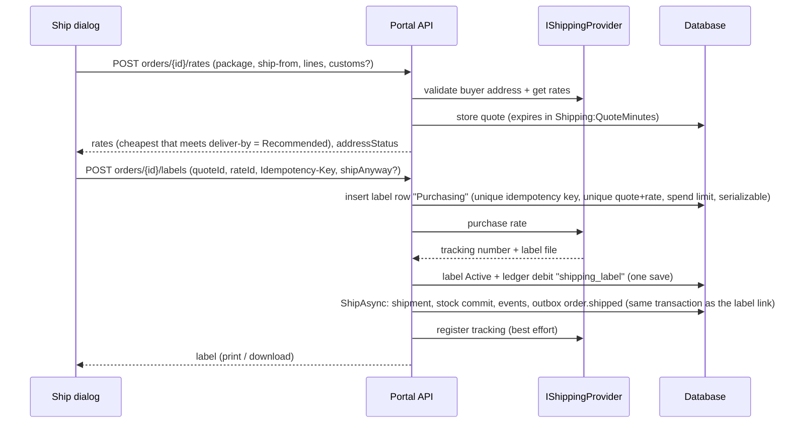
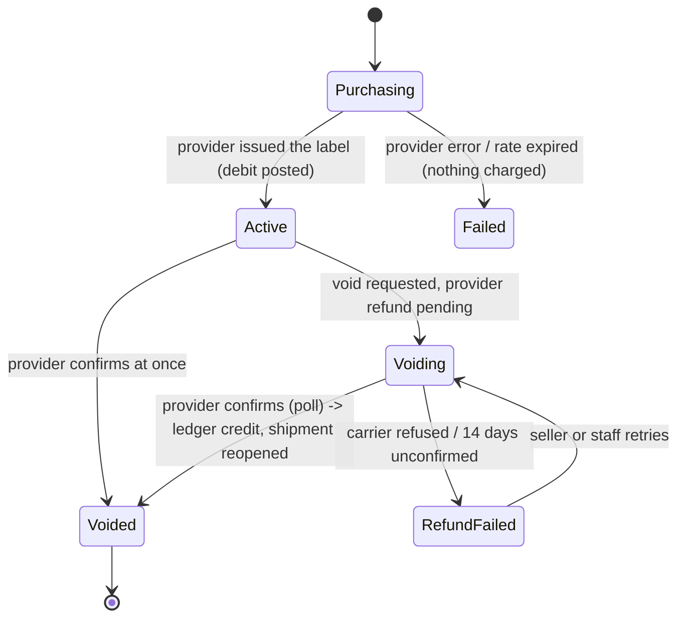
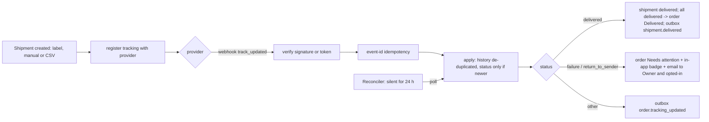

# Shipping & tracking (workstream K)

Sellers buy carrier labels in the portal, get live tracking, configure shipping once, and send prepaid return labels. Everything goes through **Shippo**
behind `IShippingProvider`. This iteration is built and tested in **Shippo test mode only**; with no key the app uses a deterministic **fake provider**
(dev, tests, E2E). CI never calls Shippo.

Code: `src/Solvelt.Api/Shipping/**` (+ small additive edits in `Orders/`, `Payments/`, `Products/`), entities `Domain/Shipping.cs`, one EF migration `Shipping`.
Tests: `tests/Solvelt.Api.Tests/Shipping*Tests.cs` (+ opt-in `tests/Solvelt.Api.ShippoTests`).

## 1. Flows

### Buying a label



A retry or double click returns the first purchase (`replayed: true`). If shipping the order fails after the purchase (for example the order changed), the label is
voided automatically and credited back once the carrier confirms; a sweep also voids labels that never got attached to a shipment.

### Void / refund



The ledger credit (`shipping_label_refund`) is posted **only when the provider confirms**. A parcel the carrier already scanned cannot be voided (`label_in_use`).
On confirmation the outbound shipment is removed, its units go back on hand and the order returns to *Accepted* / *Partially shipped*, so a new label can be bought.

### Tracking



Tracking stops after delivery, after `Shipping:TrackingStopDays` (60), or when the label is voided.

### Prepaid return label

```mermaid
sequenceDiagram
    participant S as Seller
    participant API as Portal API
    participant P as IShippingProvider
    participant M as Marketplace
    S->>API: POST orders/{id}/returns/{returnId}/label (return approved)
    API->>P: rates buyer address -> return address (is_return), cheapest, purchase
    API->>API: ledger debit (seller pays), ReturnShipment, tracking registered
    API-->>M: outbox return.label_created (short-lived signed label URL, tracking, carrier)
    M->>M: emails the buyer
    P-->>API: tracking webhook ... delivered
    API-->>S: "Return arrived - inspect and mark received" (never auto-received)
```



## 2. Data model

| Table | Purpose |
|---|---|
| `ship_from_addresses` | Ship-from addresses (account-wide or per brand), provider-validated (`valid` / `unverified`; `invalid` is refused). Exactly one default per scope (unique `(SellerId, DefaultKey)`). |
| `package_presets` | Box / envelope presets (mm, empty weight, one default per account). Products carry an optional `DefaultPackageId` (weight and dimensions already existed on products). |
| `seller_shipping_settings` | Handling days (feeds the order ship-by date), label format, return address. Brand row overrides the account row. |
| `shipping_profiles` | Zones (JSON, validated), flat or weight-based rate per speed, free-shipping threshold. Read by the marketplace. |
| `shipping_quotes` | Rate quotes handed out; a purchase must reference an unexpired one. |
| `shipping_labels` | One row per purchase attempt: status, provider ids, cost (minor units), idempotency key, `QuoteRateKey` and `ActiveShipmentKey` (both unique: one purchase per quoted rate, one live label per shipment), refund state. |
| `order_shipments` (extended) | `Method` (`carrier`, or `local` for workstream L), `TrackingStatus` and `Eta` (both L's, shared), `TrackingStatusDetail`, `TrackingStatusAt`, `LastTrackingAt`, `TrackingRegisteredAt`, `TrackingStoppedAt`, `PollLockedUntil`, `LabelId`. |
| `return_shipments` | Return parcels (same tracking fields as shipments). |
| `tracking_events` | Tracking history, **one table shared with local delivery (L)**: L's columns (`Method`, `Status`, `Detail`, `OccurredAt`, `SourceEventId` unique per order) plus K's `ReturnShipmentId`, `Location`, `Source` (webhook / poll). Carrier entries use `SourceEventId` = a hash of parcel + time + status + detail, so a replay or a webhook-plus-poll of the same fact is one entry. |
| `shipping_webhook_events` | Webhook idempotency (unique `(Provider, EventId)`) and the staff "webhook failures" view. |
| `seller_orders` (extended) | `NeedsAttention`, `AttentionReason`, `AttentionAt`. |
| `notification_preferences` (extended) | `ShippingEmails` (Owners always, others opt in). |

## 3. Normalized tracking statuses

`pre_transit`, `in_transit`, `out_for_delivery`, `delivered`, `available_for_pickup`, `return_to_sender`, `failure`, `unknown`.

| Shippo | Normalized |
|---|---|
| `PRE_TRANSIT` | `pre_transit` |
| `TRANSIT` | `in_transit` (substatus `out_for_delivery` -> `out_for_delivery`, containing `pickup` -> `available_for_pickup`) |
| `DELIVERED` | `delivered` |
| `RETURNED` | `return_to_sender` |
| `FAILURE` | `failure` |
| `UNKNOWN` / anything else | `unknown` |

`failure` and `return_to_sender` are **exceptions**. Ordering: a status replaces the current one only when its provider timestamp is newer (ties: the later stage wins);
nothing replaces `delivered`. The history keeps every entry either way.

## 4. API

Seller (all under `/api/v1/seller/shipping`; rate limit policy `shipping`):

| Endpoint | Who |
|---|---|
| `GET settings`, `PUT settings`, `POST/PUT/DELETE addresses`, `POST addresses/{id}/default`, `POST/PUT/DELETE packages`, `POST/PUT/DELETE profiles` | read: every member; write: Owner/Admin (`ShippingManage`) |
| `PUT products/{id}/package` | Owner/Admin/Manager of the brand |
| `POST orders/{id}/validate-address`, `POST orders/{id}/rates`, `POST orders/{id}/labels`, `POST labels/bulk`, `POST labels/{id}/void`, `POST labels/{id}/printed`, `POST orders/{id}/returns/{returnId}/label`, `POST orders/{id}/attention/dismiss` | `BrandWorkWrite` (Owner, Admin, Manager for their brands) |
| `GET labels`, `labels/{id}`, `labels/{id}/file`, `orders/{id}/labels`, `orders/{id}/tracking`, `summary` | `BrandWorkRead` (Viewer included) |

Orders: `GET /seller/orders?tracking=in_transit|exception|delivered`; list items carry `trackingStatus` and `needsAttention`; the detail carries per-shipment `trackingStatus`, `eta`, `labelCostCents`,
`returnShipments`, `needsAttention`; `GET /seller/orders/counts` has `exceptions`; the dashboard has `shipping: { labelsToPrint, exceptions }`.

Buying: `POST orders/{id}/labels` with `{ quoteId, rateId, idempotencyKey?, shipAnyway?: { reason } }` (the `Idempotency-Key` header also works). Errors carry a stable `code`:
`rate_expired` (re-quote), `address_unverified` (needs `shipAnyway.reason`, audited as `shipping.address_override`), `customs_required`, `spend_limit`, `purchase_in_progress`, `label_in_use`, `refund_refused`.

Webhook (provider -> portal): `POST /api/v1/shipping/webhooks/shippo`, anonymous but authenticated by **either** `X-Shipping-Signature: t=<unix>,v1=<hex HMAC-SHA256 of "t.body">` (5 minute window) **or** `?token=<Shipping:WebhookSecret>`
(Shippo cannot sign: put the token in the webhook URL). Idempotent on the event id (`event_id`, else `tracking_status.object_id`, else a body hash); unknown tracking numbers are acknowledged; processing errors answer 503 so the provider retries.

Marketplace (signed like the orders API, `/api/internal/v1`):

* `GET shipping/settings?sellerId=&brandId=` - read-only settings for checkout (the marketplace keeps charging the buyer):

```json
{ "sellerId": "…", "brandId": "…", "handlingDays": 3, "shipsFrom": { "country": "US", "region": "NY" },
  "profiles": [ { "id": "…", "name": "Default", "isDefault": true, "currency": "USD", "freeShippingThresholdCents": 7500,
    "zones": [ { "name": "Domestic", "kind": "domestic", "countries": ["US"],
      "speeds": [ { "speed": "standard", "enabled": true, "method": "flat", "flatCents": 500 },
                  { "speed": "overnight", "enabled": true, "method": "weight", "baseCents": 1500, "perKgCents": 300 } ] } ] } ] }
```

  Weight-based price = `baseCents + ceil(weightGrams / 1000) * perKgCents`; free when the items subtotal reaches the threshold. No street address leaves the portal.
* `POST returns/{marketplaceReturnId}/label-link` - a fresh short-lived link to the return label (the first one expires).

Staff (`/api/v1/admin/shipping`, permission matrix `ShippingView` for all staff, `ShippingRetry` for Support and Super admin): `sellers/{id}/shipments`, `sellers/{id}/labels`, `refunds?state=pending|failed`, `exceptions`,
`webhooks/failures`, `POST labels/{id}/refund/retry` (reason required, audited as `admin.shipping.refund_retried`).

## 5. Outbox events (to the marketplace)

`order.tracking_updated` (existing, extended **additively**):

```json
{ "order": { "sellerOrderId": "…", "sellerOrderNumber": "SO-2026-000123", "marketplaceOrderId": "MP-1" }, "kind": "shipment", "shipmentId": "…", "returnId": null,
  "carrier": "USPS", "trackingNumber": "9400…", "trackingUrl": "https://tools.usps.com/…", "status": "in_transit", "statusDetail": "Departed facility", "eta": "2026-05-09T00:00:00Z",
  "events": [ { "status": "in_transit", "detail": "Departed facility", "location": "Brooklyn, NY, US", "at": "2026-05-07T09:00:00Z" } ] }
```

Manual tracking edits send the same shape (`status` null, `events` empty). For a return parcel `kind` is `"return"` and `returnId` is the portal return id.

`shipment.delivered`: `{ order, shipmentId, carrier, trackingNumber, deliveredAt, orderDelivered }` (followed by the existing `order.delivered` when every shipment arrived).
`shipment.voided`: `{ order, shipmentId, carrier, trackingNumber }` (a refunded label reopened the shipment).
`return.label_created`: `{ order, returnId /* marketplace id */, labelId, labelUrl, labelUrlExpiresAt, trackingNumber, carrier, service, trackingUrl, labelFormat }`;
`labelUrl` is `<Shipping:PublicBaseUrl>/api/v1/shipping/public/labels/<id>?exp=<unix>&sig=<hmac>`, valid `Shipping:LabelLinkMinutes` (24 h), no login, bound to that one label.

## 6. Permissions

| | Owner | Admin | Manager | Viewer |
|---|---|---|---|---|
| Shipping settings (addresses, packages, profiles, return address) | edit | edit | read | read |
| Rates, buy / void / bulk labels, return labels, dismiss exception | yes | yes | own brands | no |
| View labels, tracking, label files | yes | yes | own brands | yes |
| Exception emails | always | opt in | opt in | opt in |

Other accounts' (and other brands') shipments, labels and quotes answer **404**. Labels are served only by `labels/{id}/file` (authorised, `private, no-store`) or the signed return-label link.

## 7. Money and the ledger

* Amounts are integer minor units plus a currency. Provider decimals are converted with **round half away from zero at the currency's last digit** (`5.505 USD` -> `551`); zero-decimal currencies (JPY, KRW, VND, CLP) are not multiplied. A label costs exactly the chosen rate's amount.
* Purchase: journal type `shipping_label`, key `shipping_label:{labelId}`: seller `Available` -cost, `Platform` +cost (kind `shipping_label`). Confirmed refund: journal `shipping_label_refund`, key `shipping_label_refund:{labelId}`, the opposite postings. Both are idempotent on the label id, carry the order id and show on the Payments transactions list and the monthly statement (`shippingLabelsCents`).
* A debit can take `Available` negative; the existing payments rules recover it from future sales before the next transfer.
* **Spend limit:** `Shipping:SpendLimitCentsPerMonth` per account and UTC month (0 = off); counts purchases not yet voided; checked in the same serializable transaction that inserts the label row.
* **Return labels: the seller pays** (same debit). Marketplace-paid return labels are a ROADMAP item.
* Provider billing is the platform's Shippo account; no card data is stored here.

## 8. Privacy and security

* Only what a label needs goes to the provider; logs carry country + postal prefix only; API keys are never logged. Order addresses follow the order retention/redaction rules.
* Production refuses a Shippo **test** key (`Shipping:AllowTestKeyInProduction`), other environments refuse a **live** key (`AllowLiveKeyOutsideProduction`), and a webhook secret is required with a key in Production.
* Concurrency: unique idempotency key + unique quote/rate + unique live-label-per-shipment; webhook events unique per provider id; per-shipment poll lease (`PollLockedUntil`, atomic UPDATE) so several instances never poll the same parcel; label-refund checks claim with an atomic update of `NextRefundCheckAt`.

## 9. Configuration (`Shipping`)

`ShippoApiKey` (or env `SHIPPO_API_KEY`), `WebhookSecret`, `AllowTestKeyInProduction`, `AllowLiveKeyOutsideProduction`, `LabelFormat` (`PDF_4x6`, `PNG`, `ZPLII`), `QuoteMinutes` (15), `SpendLimitCentsPerMonth`, `LabelLinkMinutes` (1440), `PublicBaseUrl`,
`TrackingPollAfterHours` (24), `TrackingStopDays` (60), `RefundCheckMinutes` (30), `PollBatch`, `PollLeaseMinutes`, `JobIntervalSeconds` (300), `WebhookToleranceSeconds` (300), `MaxBulk` (25), `RunBackgroundJobs`; `RateLimit:ShippingPerMinute`.

## 10. Testing

* `dotnet test` runs the fake provider and signed fake webhooks (no network). The suite covers settings, permissions/IDOR, address validation, rates and the recommended rate, idempotent and parallel purchase, expiry, spend limit, customs, void/refund and the ledger, tracking registration, webhook auth/replay/ordering, delivered/exception handling, the reconciler and its lease, return labels, staff tools and the outbox contract.
* `tests/Solvelt.Api.ShippoTests` is opt-in (needs `SHIPPO_API_KEY` with a **test** key; compiled but never run in CI, not part of `Solvelt.slnx`): it exercises address validation, rates, a label purchase, a refund request and tracking registration against Shippo test mode.
* Dev helpers (Development/Testing only): `POST /api/dev/shipping/tracking {trackingNumber, status}` pushes a signed fake webhook through the real pipeline; `POST /api/dev/shipping/run-maintenance` runs the reconciler/refund job.

## 11. Going live checklist

1. Create the platform **Shippo account**, add payment details (the platform pays Shippo; sellers are debited in the ledger), and connect the **carrier accounts** you want (USPS, UPS, FedEx, DHL Express).
2. Create a **live API token** and set `SHIPPO_API_KEY` (never commit it). Test with a `shippo_test_` token first in a non-production environment.
3. Register the **webhook** in Shippo: event `track_updated`, URL `https://<host>/api/v1/shipping/webhooks/shippo?token=<Shipping:WebhookSecret>`; set `Shipping:WebhookSecret` to a long random value.
4. Set `Shipping:PublicBaseUrl` to the public API URL (signed return-label links).
5. Choose the **label format** (`PDF_4x6` for sheet printers, `ZPLII` for thermal printers) and tell sellers to set it in Settings > Shipping.
6. Each seller adds a **ship-from address**, **package presets**, and a **return address**.
7. Set a **spend limit** (`SpendLimitCentsPerMonth`) appropriate for new sellers.
8. Confirm the marketplace consumes `order.tracking_updated`, `shipment.delivered`, `shipment.voided`, `return.label_created` and reads `GET /api/internal/v1/shipping/settings`.
9. Watch Admin > shipping tools for failed label refunds and webhook failures during the first weeks.
