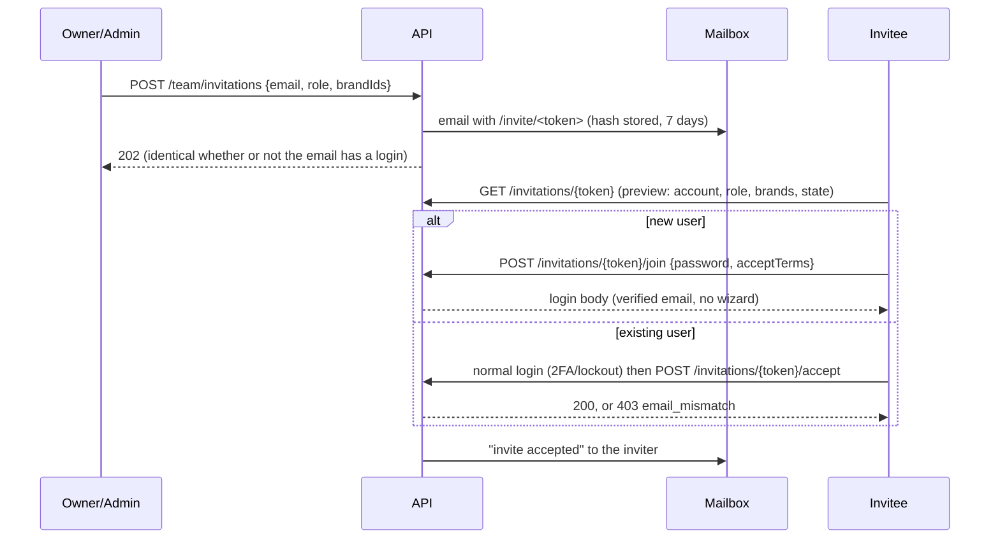

# Team members, roles & brands

One user (one login, one email) can be a member of **many seller accounts**, each membership with a **role**; one seller account has **many brands**.
Password, passkeys, 2FA, lockout and sessions stay per **user**. Code: `src/Solvelt.Api/Teams/**`, entities in `Domain/Teams.cs`.

## Data model
```
AppUser 1─* AccountMembership *─1 SellerAccount 1─* Brand
                 │  role, status (Active|Suspended), allBrands, invitedBy, lastActiveAt
                 └─* MembershipBrand *─1 Brand          (brand scope when allBrands = false)
SellerAccount 1─* AccountInvitation (email, role, scope, tokenHash, expiresAt, status)
UserSession.ActiveAccountId   AppUser.LastAccountId
```
* `SellerAccount.UserId` is kept as the *primary owner* (legacy code paths, status emails, phone module); it is updated on ownership transfer. It is **no longer unique** and is **not** used for authorization.
* `Brand`: name (unique per account, case-insensitive), slug, description, contact email/website, logo (JPEG/PNG/WebP ≤ 1 MB, magic-byte checked, random storage key), status Active/Archived, `IsDefault`.
* **Concurrency:** every membership mutation runs under a per-account lock and reads inside it, so the "≥ 1 Owner" rule holds under parallel requests (in-process semaphore + `FOR UPDATE` on PostgreSQL).
* **Backfill** (`TeamService.BackfillAsync`, idempotent, runs at startup after the schema is created/migrated; only for accounts with no membership at all, so removed Owners are never restored): every seller account gets an Owner membership for its `UserId` and a default brand named after `VendorName` (or "Main brand"). New accounts get the same; the default brand follows the vendor name until somebody edits it.

## Permission matrix
Central table: `Teams/Permissions.cs` (`Permissions.Has(role, permission)`), enforced by endpoint filters.

| Permission | Owner | Admin | Manager | Viewer |
|---|:-:|:-:|:-:|:-:|
| `AccountRead` (status, vendor name) | ✔ | ✔ | ✔ | ✔ |
| `AccountEditBusiness` (wizard, legal/business details) | ✔ | – | – | – |
| `AgreementAccept` (submit application, seller agreement) | ✔ | – | – | – |
| `OwnershipTransfer`, `AccountClose` | ✔ | – | – | – |
| `MembersRead` | ✔ | ✔ | – | – |
| `MembersManage` (invite, resend, revoke, change role/scope, remove) | ✔ | ✔ (not Owners) | – | – |
| `BrandsRead` (brands in scope) | ✔ | ✔ | ✔ | ✔ |
| `BrandsManage` (create/edit/archive, logo) | ✔ | ✔ | – | – |
| `BrandWorkRead` (products, questions … in scope) | ✔ | ✔ | ✔ | ✔ |
| `BrandWorkWrite` | ✔ | ✔ | ✔ | – |

Owner/Admin always have all-brand scope; Manager/Viewer have *all brands* or a list.
Rules: nobody edits their own role (use *Leave*); nobody changes or removes a member with a higher role, nor grants a higher role than their own; only an Owner can touch an Owner or create one (via role change or transfer); Owners can't be *invited*; an account always keeps ≥ 1 active Owner (leave/remove/demote refused with `409 last_owner`); the last active brand can't be archived (`409 last_brand`).
`AccountClose`: `POST /team/close-account` (Owner only, step-up) sets the account to `Closed`: unusable for everyone, hidden from account lists, data retained, Owners emailed (DECISIONS).

## Invitation flow

* Token: 256-bit random, only SHA-256 stored, single-use, 7-day expiry, **resend rotates the link** (old one dies). Inviting the same email again updates the one pending invite and resends (60 s cool-down, `429`).
* Throttles: 30 invites/hour per account, 20/hour per inviter (counted from the audit log); endpoints rate-limited per IP.
* **Email possession for new users is proven by the invite link itself** (it was delivered only to that mailbox, is single-use and short-lived), so no extra email code; the account is created verified. An unverified pre-registration of that address (web or phone) is deleted outright with everything it planted (phone number, PIN, seller account, memberships) and a fresh user is created; it is never adopted. If the address already has a *verified* login, join answers `409 sign_in_required` (only reachable with the emailed link). Passkey/Google at join time is deferred; the invitee can add them in Security settings.
* Existing users: accept requires the **verified** account email to equal the invited one (case-insensitive, trimmed); otherwise `403 email_mismatch`. `GET /account/invitations` lists a signed-in user's pending invites; `…/{id}/accept|decline` act by id (404 for invites addressed to someone else).
* Invitation states: `pending, expired, revoked, accepted, declined` (`410 invite_<state>` on use). Unknown tokens: uniform `404`.
* Emails (own file `Teams/TeamTemplates.cs`, HTML+text+preheader): invitation, invite accepted, role/scope changed, removed, ownership transferred, transfer step-up code.
* Audit: `invite.created/resent/revoked/accepted/declined/accept_refused`, `team.role_changed/scope_changed/member_removed/member_left/ownership_transferred/stepup_failed`, `brand.*`, `session.account_switched`, `account.created`. No tokens or links are logged.

## Sessions and account switching
* Login/refresh bodies keep the original fields; `sellerId`, `vendorName` describe the **active** account (`Guid.Empty`/`""` when none) and are joined by `activeAccountId` and `accounts: [{sellerId, vendorName, role, accountStatus, brandCount}]` (last used first). `accountStatus` at the top level keeps its original meaning (sign-in state, DECISIONS #9); each account's approval status is `accounts[].accountStatus`. `GET /account/me`, `GET /auth/session` and `GET /session` return the same account info.
* The active account is stored on the session: exactly one usable account → auto; several → the user's last used if still valid, else **the client must choose** (`POST /api/v1/session/account {sellerId}` → new access token with `acc`/`arole` claims; non-member → `404`).
* **Every authenticated request** re-reads the membership (active, role, scope) and the account status (Rejected/Suspended accounts are unusable) from the database (`OnTokenValidated`); the token claims are only hints. Removal/demotion/scope change therefore apply on the very next request; a request without a valid active account gets `403 no_active_account` on account-scoped endpoints.
* Zero memberships: sign-in still works; `accounts` is empty. Such a user can list/accept invites and `POST /account/seller-accounts {acceptTerms}` (new Draft account, goes through the wizard + approval).
* Sign-in is refused only when **every** account of the user is Rejected/Suspended (as before for single-account users). A status change to Rejected/Suspended revokes the sessions of members whose only usable account it is; others keep their sessions but lose that account.
* Removing a member revokes access to that account only; there is no "sign out everywhere" for other people.

## Brand scoping
Use `db.BrandsFor(access)` for every brand/product query (account + scope), and `db.RequireBrandAccess(access, brandId, write)` to load one (returns `null` → answer **404**, so other accounts' and out-of-scope brands look missing). `AccountAccess.CanWorkOnBrand(brandId, write)` combines scope and `BrandWorkRead/Write`. Brands inherit the account's approval status.

## Integration notes for products and phone
* **Current account/role/scope:** inside a handler take `HttpContext ctx` and call `ctx.GetAccess()` → `AccountAccess { UserId, SellerId, MembershipId, Role, AllBrands, BrandIds, AccountStatus }` (null when no valid active account). It is re-validated per request; never read `SellerAccount.UserId` for authorization.
* **Guard endpoints:** `.RequireAuthorization("Seller")` then `.RequirePermission(Permission.X)`, `.RequireAccountRole(AccountRole.Admin)` or `.RequireActiveAccount()` (extension methods in `Teams/Access.cs`; they answer 403 `no_active_account` / `forbidden`).
* **Products** must carry `SellerId` + `BrandId` (exactly one brand). List with `db.BrandsFor(access)` joined/filtered by `BrandId`; load one with `await db.RequireBrandAccess(access, brandId, write: true)` before writing; use `Permission.BrandWorkRead/Write`. Treat everything outside the active account/scope as 404.
* **Account switching** is session-wide; the frontend sends the access token only; the active account is in the token (`acc`), the truth in the DB.
* **Phone/SMS** (worker C) keys on the user/primary account (`SellerAccount.UserId`, which follows ownership transfers). For account-scoped phone features use `ctx.GetAccess()` for HTTP, and for IVR/SMS callers resolve the user's memberships via `AccountContextService.ListAsync(userId)` / `ResolveAsync(userId, sellerId)`, then apply the same permission table (`Permissions.Has`).
* Add new permissions to `Permission` + the matrix in `Permissions.cs`, and a row to the table above; the matrix test in `TeamsTests` iterates roles × endpoints.

## API summary (`/api/v1`)
`session` (GET), `session/account` (POST) · `team/members` (GET, PATCH/DELETE `{id}`), `team/leave`, `team/transfer-ownership` (step-up: password, or mailed code for passwordless accounts; plus TOTP when enabled), `team/close-account`, `team/invitations` (GET, POST, `{id}/resend`, DELETE `{id}`) · `invitations/{token}` (GET preview, `accept`, `decline`, `join`) · `account/invitations` (+ `{id}/accept|decline`), `account/seller-accounts` (POST) · `brands` (GET, POST, GET/PUT `{id}`, `archive`, `restore`, `logo` POST/GET/DELETE).
